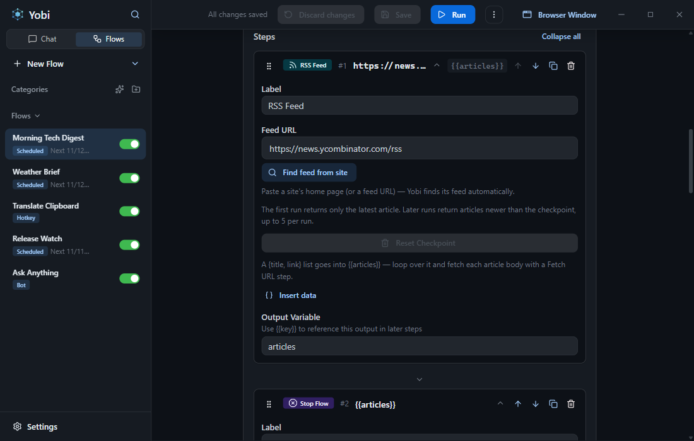
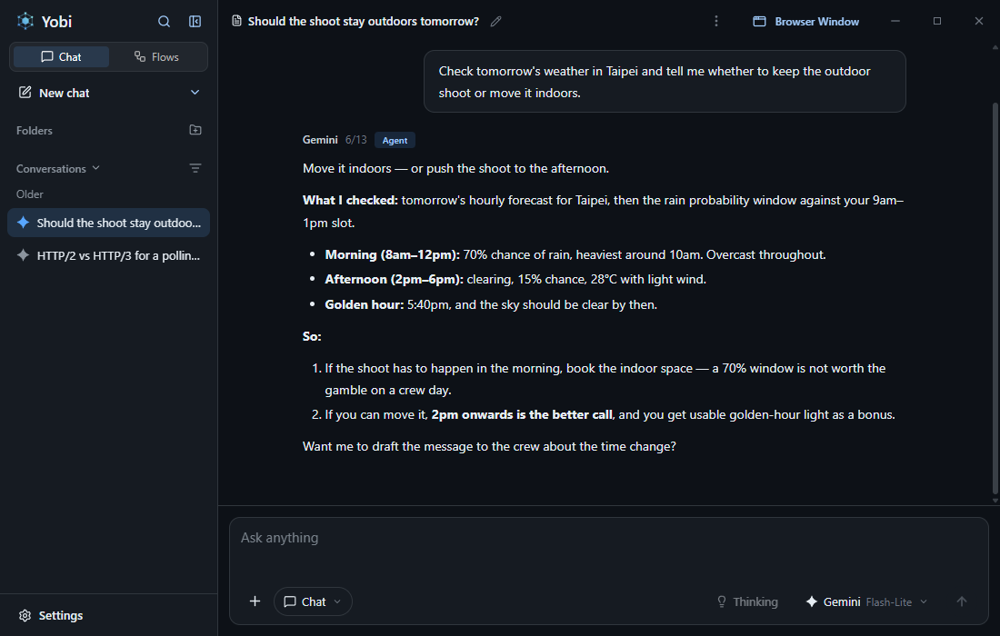
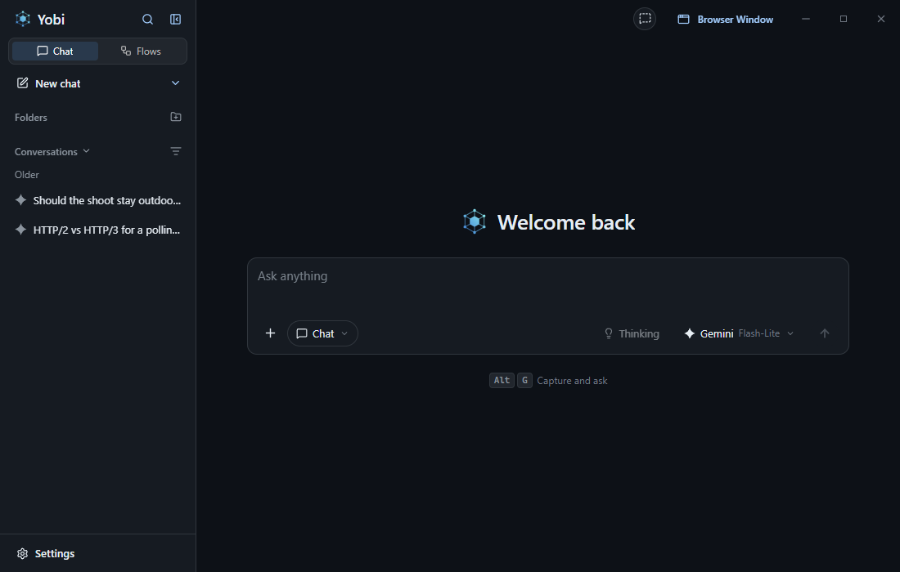
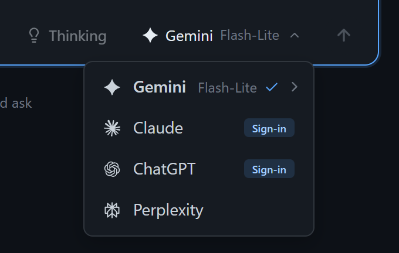
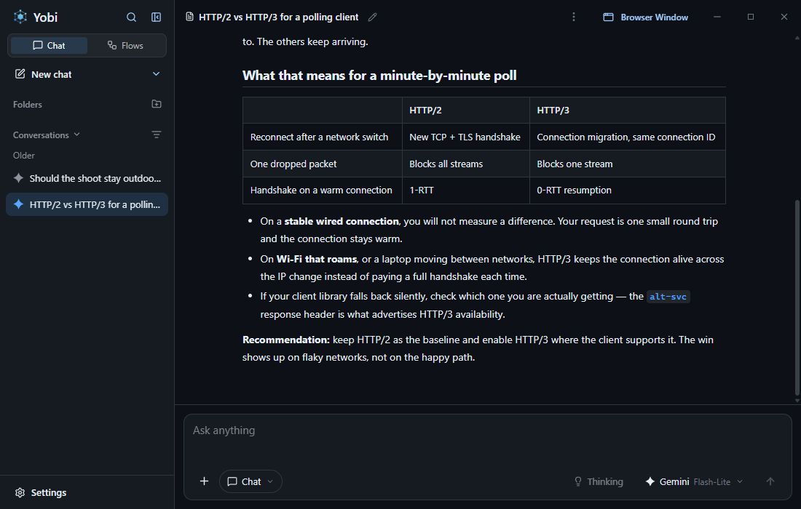
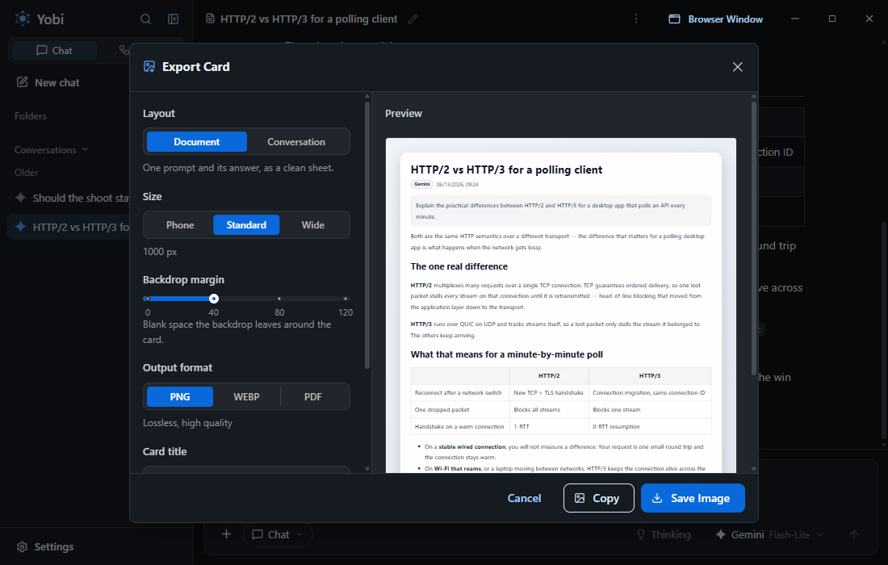

<div align="center">

# Yobi

**A desktop AI tool for chat, an agent and automated flows. No API key needed by default.**

[](LICENSE)
[](#get-started)
[](https://apps.microsoft.com/detail/9nnx8prfstc9)
[](https://www.electronjs.org/)
[](https://github.com/WellWells/yobi/pulls)

**[English](README.md) · [简体中文](README.zh-CN.md) · [繁體中文](README.zh-TW.md)**

</div>

---

**Yobi** brings AI chat, an agent and automated flows to your desktop. Select text and ask with a hotkey, have the agent look things up and use tools, or save a recurring task as a scheduled flow. You can also use the AI and flows on this computer through Telegram, LINE, Discord or Slack.

By default, Yobi operates the Gemini, Claude, ChatGPT, Perplexity and DeepSeek websites. No API key or API usage charge is involved; available models and quotas still depend on each provider's plan. If you use your own key (BYOK), that API service's pricing and quotas apply.

Flows run on your computer; AI answers usually come from an external service. **Schedules and bots need the computer awake and Yobi running.** Online features also need an internet connection.

<!-- demos:hero:start -->
<p align="center"></p>
<!-- demos:hero:end -->

---

## What You Can Do

- **Chat and writing**: switch providers and models, rewrite a selected passage, translate an answer or a whole conversation, and export Markdown, PDF or images.
- **Agent**: describe a task and let AI search, read data and call tools, including skills you install. See [Security & Privacy](#security--privacy) for what needs approval.
- **Flows**: 61 kinds of step, chained with `{{variables}}`. Add steps from a menu, or describe the task and let AI build a flow you can edit.
- **Connectors**: use LINE on this PC (Windows), Thunderbird, mail, calendars, Notion, GitHub and other MCP services.
- **Links and media**: read articles and posts, analyze comments or Google Maps reviews, download supported videos, MP3s and subtitles, or ask Gemini or ChatGPT to make pictures.
- **Taiwan services**: PTT, TRA, THSR, seven metro systems and uniform invoice prize checking.
- **Interface languages**: English, 繁體中文 and 简体中文, plus [language packs](language/README.md).

---

<!-- demos:start -->
## See It in Action

<table>
<tr>
<td width="33%" valign="top">
<a href="assets/demos/en-US/flow-build.webp"></a>
<br /><b>Build a flow from a description</b>
<br /><sub>A one-sentence description becomes a flow that runs as is or can be edited step by step.</sub>
</td>
<td width="33%" valign="top">
<a href="assets/demos/en-US/writing.webp"></a>
<br /><b>Rewrite a selected passage</b>
<br /><sub>Rewrites only the selected passage of an answer, in place in the Markdown.</sub>
</td>
<td width="33%" valign="top">
<a href="assets/demos/en-US/telegram.webp"></a>
<br /><b>Google Maps reviews over Telegram</b>
<br /><sub>A Google Maps link sent to the Telegram bot is analyzed on the desktop, and the review summary is sent back.</sub>
</td>
</tr>
<tr>
<td width="33%" valign="top">
<a href="assets/demos/en-US/downloader.webp"></a>
<br /><b>Download video from a post link</b>
<br /><sub>Saves the video from a pasted post link; questions about the post are also supported.</sub>
</td>
<td width="33%" valign="top">
<a href="assets/demos/en-US/notion.webp"></a>
<br /><b>Import and edit a Notion page</b>
<br /><sub>Imports a Notion page for AI-assisted editing and syncs the changes back to Notion.</sub>
</td>
<td width="33%" valign="top">
<a href="assets/demos/en-US/thunderbird.webp"></a>
<br /><b>Summarize email in Thunderbird</b>
<br /><sub>Summarizes messages from Thunderbird on this PC.</sub>
</td>
</tr>
<tr>
<td width="33%" valign="top">
<a href="assets/demos/en-US/files.webp"></a>
<br /><b>Summarize files on this PC</b>
<br /><sub>Reads files on this PC and summarizes them in one place.</sub>
</td>
</tr>
</table>
<!-- demos:end -->

---

## Flows

A flow is a chain of steps. Each step's output feeds the next through `{{variables}}`:

```
Schedule   every day at 09:00
    ↓
LINE       → {{chat}}      a group's messages since yesterday
    ↓
Ask AI     → {{summary}}   summarize, pull out decisions and open items
    ↓
Telegram   send {{summary}}
```

Or describe it and AI builds the flow for you; every step stays editable:

> *"Every weekday at 8am, summarize my RSS feed and send it to Telegram."*

There are 30 templates to start from, run on a schedule, by a hotkey on selected text, when a file lands in a folder, or as a command in chat or to your bot.

**Steps:**

- **Pull data** — web pages, RSS, HTTP APIs, YouTube transcripts and new videos, web search and deep research, Google Maps reviews, LINE chats, Telegram groups, X posts, replies and trends, new mail, your calendar, stocks, forex, weather, air quality
- **Use a connector** — any tool of a connector you've added, such as Notion or Jira
- **Scrape a list** — click one headline on the page and Yobi finds the rest
- **Drive a browser** — open tabs, click, fill forms, take screenshots
- **Ask AI** — Gemini, Claude, ChatGPT, Perplexity, DeepSeek or BYOK
- **Send results** — Telegram, LINE, Discord, Slack, email, a file, PDF, image or share link, the clipboard, a notification
- **Run anything** — programs, JavaScript, shell, system and power controls
- **Control flow** — loops, conditions, delays, stop early, "only tell me when it changes"

Flows are plain `.json` files. An export leaves out your variable values and bot account IDs; an import shows what the flow will access first.

Edits take effect when you save. Enabled flows run on their triggers, and version history lets you inspect and restore earlier versions. **A configured flow does not ask again before each action**: review sending, file changes, deletion and system commands before enabling it. Connector steps triggered by a bot may read data but cannot change remote data.

---

## Connectors

**On this PC:**

- **LINE** (Windows) — list chats, search messages and read conversations from the running LINE desktop app, and send as you, asking first every time. It marks nothing as read. Flows use the **LINE Messages** step.
- **Thunderbird** — search, read, write, reply, forward and file mail, plus calendar, tasks and contacts. Needs the Thunderbird MCP add-on (linked in **Settings → Connectors**). Flows send mail with the **Send Email** step.

**Mail.** Add mailboxes in **Settings → Connectors → Mail**: Gmail, Yahoo or iCloud with an app password, Outlook, Hotmail or Microsoft 365 with **Sign in with Microsoft**, or any IMAP/SMTP server. The agent searches all of them and can read, save attachments, draft, reply, send, file and trash mail; sending and trashing ask every time. Flows use **Read new mail** and **Send Email**.

**Calendars.** Add .ics subscriptions or CalDAV accounts in **Settings → Connectors**. Subscriptions are read-only; CalDAV also supports creating, editing and deleting events.

**Free Translate.** On by default. The agent can use Microsoft to translate text and subtitle files without a translation API key. Supported formats are SRT, VTT, SBV, ASS, SSA and LRC; subtitles keep their timing and are saved as a new file. Provide a file path on this computer: attaching a file does not pass it directly to this tool. Content goes to Microsoft, and translation does not consider surrounding lines, so treat it as a draft. The agent itself still uses your selected model's quota.

**Universal Page Reader.** On by default. Give the agent a link and it reads the text itself, without the menus and related stories: news, blogs, documentation, forums and posts on sites like Reddit, X and LinkedIn. Paste a link in chat or send it to a bot; a Google News link is followed to the article. Send a bot a link alone and a complete page comes straight back as its main text, with no model involved and an Analyze button under it; a link with words around it, or a page that reads incomplete, goes to the agent. Public pages only: what needs a sign-in (Zhihu, for one) stays shut, and subscriber articles give only their public opening.

**X (Twitter).** Search posts, see trends, read an account's latest posts and the replies to a post. Turn it on and sign in under **Settings → Connectors**; search and trends need the sign-in. Mention X or Twitter in a message and the agent looks there. Flows use **X Accounts**, **X Post & Replies** and **X Trends**. Signed out, you get each account's newest few posts and top replies, and no trends.

**Instagram, Facebook, Threads and bilibili.** Each has a connector and sign-in entry for reading posts or video information. Access depends on the website and your account; Instagram and Facebook stories require sign-in, as do bilibili subtitles.

**Taiwan.** PTT and Taiwan railways are enabled by default for Taiwan users. PTT finds boards, filters posts and reads text and replies. Taiwan railways provides TRA and THSR timetables and fares, plus routes, fares, next arrivals and operating status for seven metro systems, using the operators' websites.

**Cloud services.** Connect once (most ask you to sign in, GitHub takes a token, Reference needs nothing):

- **Work** — Notion · Linear · Asana · Atlassian (Jira & Confluence) · Airtable · Dropbox · Zapier
- **Development** — GitHub · Sentry · Vercel · Netlify · Supabase · Neon · Cloudflare
- **Design** — Figma · Webflow · Wix
- **Business** — Stripe · Square · PayPal · Intercom
- **Reference** — Context7 · DeepWiki · Microsoft Learn · Cloudflare Docs · Hugging Face

Add other MCP services by their supported HTTPS endpoints in **Settings → Connectors**. Cloud catalog services need to be added and connected; Universal Page Reader and Free Translate are on by default, while PTT and Taiwan railways depend on your region. Agent changes require approval according to their risk; **Always allow this server** never skips approval for sending or deleting.

---

## Triggers

| Trigger | For |
| ------- | --- |
| **Schedule** | A digest every weekday morning |
| **Global hotkey** | A key combination in any app; the flow gets the selected text |
| **Bot message** | A `/command` you name, sent to your Telegram, LINE, Discord or Slack bot; you choose which paired accounts may use it |
| **Slash command** | `/yourflow` in the app's chat box |
| **New file** | Each file saved, downloaded or moved into a folder, once it finishes writing |
| **System event** | Yobi starts, the PC wakes, or the screen locks or unlocks (lock and unlock on Windows and macOS only) |

---

## Chat and the Agent

Give `/agent` a task. It can plan, search, call available tools and check results, or create and edit flows for later use. New agent-created flows are saved switched off. See [Security & Privacy](#security--privacy) for what needs approval.

In chat, pick **Agent** in the mode menu under the input, or turn on **Web** or a connector there. With all of them off, chat is a normal conversation saved as a Markdown file you can reopen. A question that needs a lookup (weather, a stock price, an exchange rate) still goes to the agent, for that one message.

`Shift+Tab` cycles providers and models; `Ctrl+G` opens your draft in an external editor. Answers render Mermaid and math and export to PNG, WebP or PDF; a conversation can become an end-to-end encrypted share link.

Select text in an answer to rewrite or translate it, or edit the Markdown block by block. Translated answers can be shown beside the original. **Translate the whole conversation** creates a new conversation and keeps the original file. In the Traditional Chinese interface, **Convert to Traditional** runs locally with OpenCC and sends no request.

With Notion connected, import a page from the chat sidebar, edit it in Yobi or ask the **Writing assistant** for changes. The document marks differences from Notion; nothing is sent until you click **Sync to Notion**. Resolve conflicts when both copies have changed. Tables, databases and some complex blocks cannot be edited directly.

Personal memory keeps short facts about you, such as your city or how you like answers. The AI saves one when it comes up and shows it under the answer with **Undo**. Edit them in **Settings → Personal memory**; **Tidy up** suggests merges and deletions, and only the ones you tick apply.

---

## Skills

A skill gives the agent instructions for a type of work, in a `SKILL.md` file with optional scripts and references. Manage them in **Settings → Skills**:

- Import from a folder, GitHub, a `.zip`, `.skill` or `.md` file, or other AI tools on this computer. Review the preview before installing.
- Write one yourself, ask AI for a draft, or choose **Save as skill** from a conversation's menu. A draft becomes a skill only when you save it.
- **Check** inspects files and runs supported script examples locally. **Try it** uses the selected model to handle a real request. Passing checks does not prove the content is correct.
- Skills shipped with Yobi can be disabled, updated or restored. GitHub imports can be checked for newer versions, which you still preview before installing.

The bundled **Taiwan price comparison** skill compares a shopping link or product model across stores. It needs **Web** enabled and cites the prices it can verify; price history is included only when readable evidence is available, without claiming an all-time or market-wide low.

Export skills as `.zip` files. A shared format does not make every skill work unchanged: external programs must be installed separately, and settings specific to other AI tools do not execute in Yobi. Skill JavaScript runs in a sandbox with file and network restrictions; external commands follow the [approval rules](#security--privacy).

---

## Links, Downloads and Pictures

Paste a supported link to show its content or download menu; add a question to send it to the agent. Turn automatic recognition on or off per site in **Settings → Links & downloads**. Defaults depend on interface language and region.

- **Posts**: X, Threads, Instagram, Facebook, TikTok, Reddit and Weibo, plus PTT and Dcard for Taiwan users. Read text, get available media and analyze retrieved comments. Comments may be a sample; stories have no comment analysis.
- **Video and audio**: YouTube, bilibili, Vimeo, SoundCloud and unencrypted `.m3u8` streams. Qualities, MP3, subtitles and analysis depend on the site and the individual item. SoundCloud is audio-focused. Downloads handle one item at a time; whole playlists and live streams are unsupported.
- **Place reviews**: paste a Google Maps link for review analysis, or ask the agent to read Agoda hotel reviews. Results cover only the reviews it can retrieve.
- **Pictures**: describe what to draw, optionally naming Gemini or ChatGPT; Gemini is the default. The agent can also ask a web provider to draw from information it found. BYOK does not generate pictures directly: an available web service and its quota are still needed.

The app can install yt-dlp and FFmpeg for the downloader. Downloads go to `Downloads/Yobi` by default and are kept for three days unless you change the setting. Bot file delivery depends on the platform, account permissions and size limits; the LINE official-account bot differs from LINE PC. Sites may require sign-in or verification, and website changes can break reading. Yobi does not remove DRM.

---

## Get Started

**1. Install:**

```bash
brew install --cask wellwells/tap/yobi   # macOS (Intel & Apple Silicon)
```

```powershell
# Windows: Microsoft Store build, updated by the Store
winget install 9NNX8PRFSTC9

# Windows: GitHub build, updates itself (paste into PowerShell)
irm https://github.com/WellWells/yobi/releases/latest/download/install.ps1 | iex
```

Or get it from the [Microsoft Store](https://apps.microsoft.com/detail/9nnx8prfstc9) or [GitHub Releases](https://github.com/WellWells/yobi/releases) (Windows installer, macOS DMG). GitHub builds are unsigned: if you download the Windows installer in a browser, choose **More info → Run anyway**; for macOS see the [release notes](https://github.com/WellWells/yobi/releases). With Smart App Control on, Windows blocks the GitHub build, so use the Store build.

**2. Try it:**

1. Gemini (the default) and Perplexity work without an account. For Claude, ChatGPT or DeepSeek, click **Sign in** next to it in **Settings → AI Models**.
2. Select some text in any app.
3. Press **`Alt+G`** (`⌘⌃G` on macOS). The answer is copied to your clipboard and the conversation is saved in **Chat**.

**`Alt+J`** (`⌘⌃J` on macOS) does the same for part of the screen: drag a box, then ask about it.

Then open **Flows → Templates**.

<details>
<summary><b>Run from source</b> (Node.js 24+)</summary>

```bash
git clone https://github.com/WellWells/yobi.git
cd yobi
npm install   # on Windows without Visual Studio: npm install --ignore-scripts
npm run dev
```
</details>

---

## Screenshots

| Flow Editor | `/agent` |
| :---------: | :------: |
|  |  |
| Fetch, summarize with AI, send to Telegram on a schedule | Give it a goal; it picks the tools |

| Chat | Model Selection |
| :--: | :-------------: |
|  |  |
| Chat through the AI's web page | Switch provider and model |

| Chat History | Export |
| :----------: | :----: |
|  |  |
| Conversations are Markdown files you can reopen | PNG, WebP or PDF, with custom styles |

---

## Run It From Your Phone

Connect a Telegram, LINE, Discord or Slack bot to use your AI and flows from your phone. Yobi on this computer handles the work; it cannot respond while the computer is off or asleep, or Yobi is closed. To set up Telegram:

1. Message [@BotFather](https://t.me/BotFather) to create a bot and copy its token.
2. In **Settings → Bot Integrations**, turn on **Enable Telegram Bot**, paste the token into **Bot Token** and click **Save token**.
3. Click **Generate Code** and send `/start <code>` to your bot, or click **Open Telegram**.

**LINE PC (Windows):** use your own LINE account, without an official account or webhook. Enable local LINE in **Settings → Connectors**, then enable LINE PC in **Bot Integrations**. LINE desktop must be running and signed in. Start a group message, or a message you send in a direct chat, with "Yobi", such as "Yobi will it rain tomorrow?" Replies come from your account, prefixed `[Yobi]`. Other group members need your permission to start using it; the other person's direct messages do not trigger it. Pictures, videos and files can be sent back.

**LINE official account:** create a Messaging API channel in the LINE Developers Console, paste its **Channel access token** and **Channel secret** into the LINE card, and open a tunnel to Yobi's local webhook (the card shows the `cloudflared` command). To pair, click **Generate pairing code** and send the person the link. This mode cannot upload local files directly, so a download may stay on the computer.

**Discord and Slack** connect out from this PC, so no tunnel is needed. Discord: create an application in the Developer Portal and paste its bot token. Slack: create the app from the manifest on the Slack card and paste its two tokens. Pairing works like LINE.

An unpaired person who messages the bot privately is asking to join. Allow or block them in **Settings → Bot Integrations**; Telegram and LINE also send you a card with **Allow** and **Block**.

| Command | Does |
| ------- | ---- |
| `/gemini` · `/claude` · `/gpt` · `/pplx` | Ask that provider; each BYOK key and key group gets its own command too (names are customizable) |
| `/search` | Search the web and answer with sources (needs **Web search**) |
| `/new` | Start a new conversation (also happens after 6 idle hours) |
| `/help` | List the commands you can use (LINE) |
| `/status` | See the work queue (Telegram, admin) |
| `/restart` | Restart Yobi (Telegram, admin) |
| `/users` · `/invite` · `/groups` | Handle join requests and permissions, send an invite link that expires, choose which groups may use the bot (Telegram admins; on LINE, only you) |

Ordinary messages use the bot's **Default model**, which decides whether to search or use tools; a supported bare link may be read or downloaded without a model. Ask for a file, like "make it a PDF", and platforms that support file replies can return PDF, PNG or WebP. Normal pairing allows chat and model commands; grant more per account: **Agent**, **Web search**, **Read this computer**, **Run commands** (approval every time), connectors and **Admin** (Telegram only). LINE PC automatically pairs the signed-in account as you on first connection; Run commands still needs a separate grant.

You and your admins can ask the bot in a private chat to build or change a flow, such as "every morning at 8, send me the weather". The bot asks you before saving. Flows that run things on your PC, and admin-built flows that read your data or act as you (save files, send mail, open pages in your signed-in browser), are saved switched off for you to check on the desktop.

A **Bot** trigger adds your own command, like `/my_cmd`, on every platform. Text after the command goes into the flow; it's available to **Everyone paired** or **Selected people**.

---

## Settings

AI Models · AI Responses · Personal memory · Connectors · Skills · Bot Integrations · General · Appearance · Notifications · Links & downloads · Export · Keyboard shortcuts · Statistics · Backup & Restore.

**BYOK:** in **AI Models → Your Own API Keys (BYOK)**, click **Add key** and pick a provider (OpenAI, Anthropic, Google Gemini, OpenRouter, DeepSeek and more), or **OpenAI-compatible** for any other endpoint, including a local server. The key shows up in the chat model menu, in flow AI steps and as a bot command. **Key groups (rotation)** take turns across several keys and move on when one fails. Attachment support depends on the provider type; support for images does not imply support for PDFs or other documents.

**Backup & Restore** can save settings (including encrypted keys and passwords), flows, Markdown conversations, memory, skills and version history to one .zip. Choose categories when backing up or restoring. Keys and passwords restore only on the device that made the backup. Downloads, cached chat pictures and website sign-ins are not included; save pictures and attachments separately if you want to keep them.

---

## How Yobi Works

By default, AI requests go through the provider's **website**: Yobi enters your prompt in a built-in browser and reads the answer back. Gemini and Perplexity can work signed out; Claude, ChatGPT and DeepSeek require sign-in. Yobi itself does not run an AI model. BYOK calls your chosen endpoint instead, which can also be a local model server you set up separately.

This is unofficial web automation. Sign-in requirements, models, quotas and website interfaces can change. Verification may need you to act in the browser window; Yobi does not solve CAPTCHAs or rotate IPs. Website changes or restrictions on automation may make a feature temporarily unavailable.

Providers have different rules for automated access. [OpenAI's Terms of Use](https://openai.com/policies/terms-of-use/) prohibit automatic extraction of data or output; [Anthropic's Consumer Terms](https://www.anthropic.com/legal/consumer-terms) restrict automated access outside its API unless explicitly permitted. Check your chosen service's current terms and account restrictions. Being able to operate a website does not mean its provider permits this use.

---

## Security & Privacy

- **What the AI receives.** Prompts, conversation context, attachments in use and tool results go to the selected AI website or BYOK endpoint. Enabled personal memory and answer preferences may be included. The provider's privacy policy applies; running locally does not mean data stays on this computer.
- **No server, no telemetry.** Yobi has no account and no analytics. Conversations, flows, memory and exports are plain files on your disk.
- **Other network traffic.** Search terms go to Brave Search and Bing, falling back to DuckDuckGo when both are unavailable. Microsoft receives text sent for translation. Connectors communicate with services you enable or add; GitHub skills check for updates. Shared content is encrypted in the app before upload to PrivateBin (privatebin.net unless you set your own), with the key in the link's `#fragment`; anyone with the complete link can decrypt it. Non-Store builds check GitHub for Yobi updates at startup.
- **Agent file access.** Built-in file readers are limited to the output folder, Documents, Downloads, Desktop and chat media. File writes are limited to the output folder and do not ask for approval on each call. Recognizable keys and tokens in tool content are masked before reaching the model; this cannot identify every secret.
- **Agent approvals.** Saving or editing flows, connector changes requiring approval, and shell commands ask first. Connector operations that send or delete ask every time; some reversible operations can run directly. On the desktop, **Always allow** in the command confirmation dialog can authorize a program, action and options. New options, other commands and bot commands still ask; revoke approvals in **Settings → Skills**. Approved shell commands run with your operating-system account's permissions and are not confined to the file folders above.
- **Bot permissions.** Grant access per account and group in **Settings → Bot Integrations**. Personal data, system commands and changes have stricter limits; some public-data connectors work in groups, and LINE PC has exceptions for the owner. Agent changes to connector data from a bot require your own private chat and confirmation. Flows follow their saved configuration instead of the agent's per-call approval process.
- **Encrypted credentials.** Bot tokens, mailbox passwords and Microsoft sign-ins, API keys, connector sign-ins and the LINE database key are encrypted with the OS key store (Electron `safeStorage`).

---

## Guides

- [Yobi: AI automation that drives ChatGPT & Gemini through their web interfaces](https://wellstsai.com/en/post/yobi-free-ai-automation/) — overview and setup
- [Build an AI Telegram news bot from RSS, with no server and no API key](https://wellstsai.com/en/post/telegram-bot-rss-ai-digest/) — one flow, start to finish
- [How to get a free LLM API key: Gemini and OpenRouter quotas, tested](https://wellstsai.com/en/post/free-ai-api-key/) — for BYOK

---

## Development

```bash
npm run dev         # dev mode; press Enter to restart Electron after main-process changes
npm run typecheck   # TypeScript type checking
npm run i18n:check  # compare language/*.json with the source; deletes unused keys
npm run build:win   # Windows (NSIS installer)
npm run build:mac   # macOS (DMG)
```

**Stack:** Electron · React + TypeScript · Mantine · Zustand · Vite + electron-builder · grammY · LINE Bot SDK · MCP SDK

---

## Contributing

Issues and PRs are welcome. Make sure `npm run typecheck` passes. User-facing text goes in `language/*.json`, in en-US, zh-TW and zh-CN; for another language see [language/README.md](language/README.md). For big changes, open an issue first.

---

## License

[MIT](LICENSE). See [NOTICE](NOTICE) for what the license does not cover.

---

<div align="center">

**[Report a Bug](https://github.com/WellWells/yobi/issues) · [Request a Feature](https://github.com/WellWells/yobi/issues) · [Discussions](https://github.com/WellWells/yobi/discussions)**

</div>
