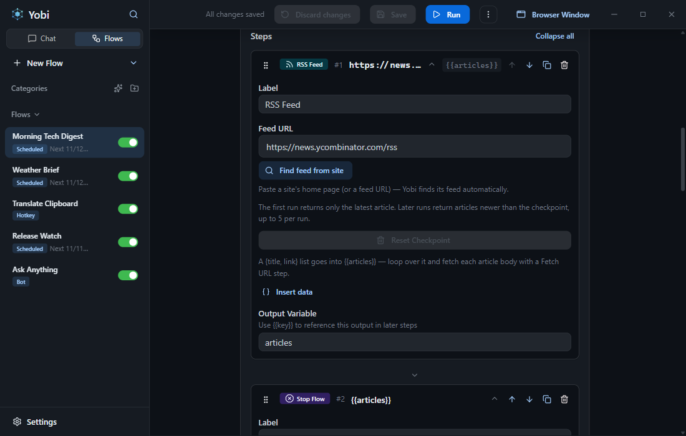
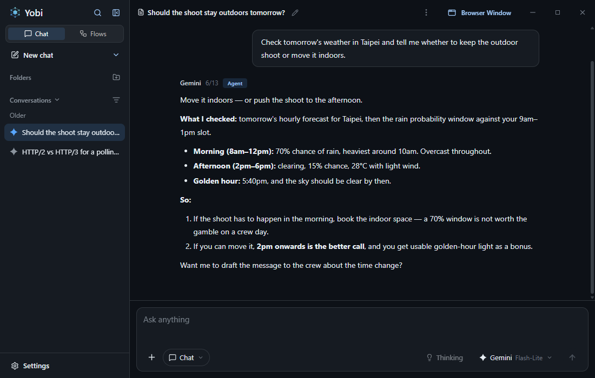
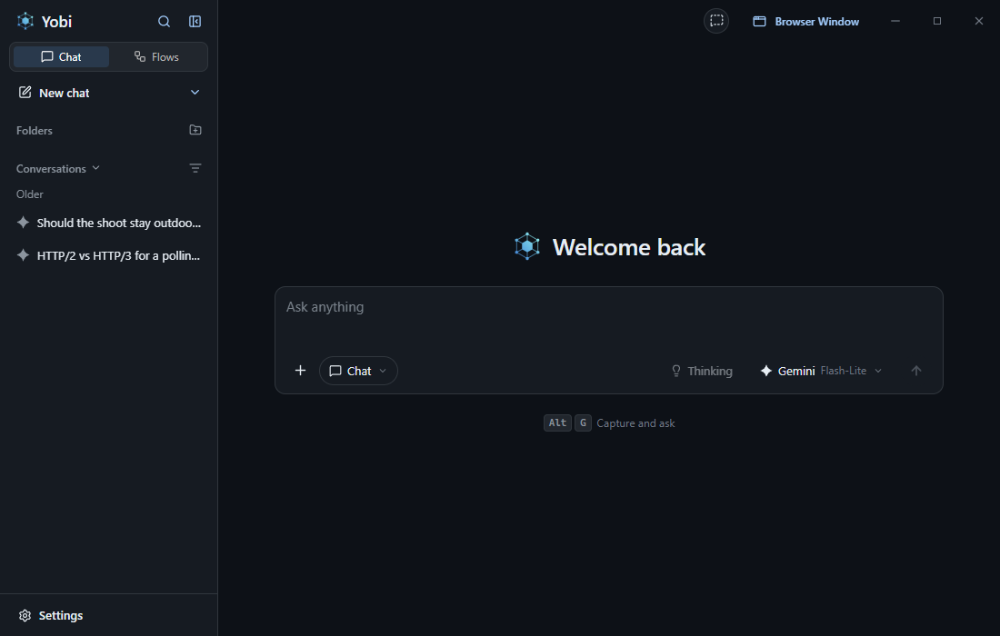
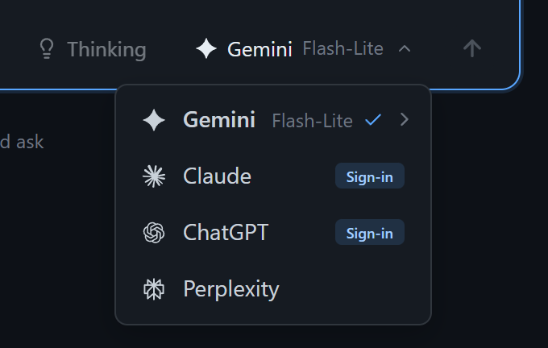
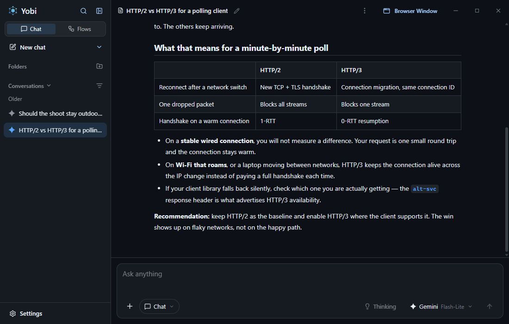
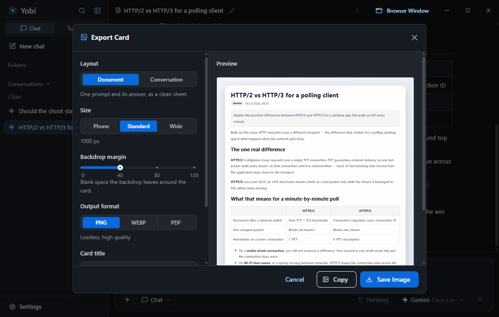

<div align="center">

# Yobi

**桌面 AI 工具：聊天、Agent 与自动化流程，默认无需 API Key。**

[](LICENSE)
[](#开始使用)
[](https://apps.microsoft.com/detail/9nnx8prfstc9)
[](https://www.electronjs.org/)
[](https://github.com/WellWells/yobi/pulls)

**[English](README.md) · [简体中文](README.zh-CN.md) · [繁體中文](README.zh-TW.md)**

</div>

---

**Yobi** 把 AI 聊天、Agent 与自动化流程放在桌面上。你可以选中文字后按热键提问，让 Agent 查资料、使用工具，或把固定工作存成流程，定时运行。也能通过 Telegram、LINE、Discord 或 Slack 使用这台电脑上的 AI 与流程。

默认操作 Gemini、Claude、ChatGPT、Perplexity 与 DeepSeek 的网页版，无需 API Key，也不产生 API 用量费用；可用模型与额度仍取决于各家方案。选择自备密钥（BYOK）时，费用与额度按该 API 服务计算。

流程在你的电脑上运行，AI 回答通常由外部服务生成。**定时任务与 Bot 需要电脑保持开机、未休眠，并让 Yobi 持续运行**；联网功能也需要网络。

<!-- demos:hero:start -->
<p align="center"></p>
<!-- demos:hero:end -->

---

## 能做什么

- **聊天与写作**：切换 AI 服务商与模型，改写选中段落、翻译回答或整段对话，导出 Markdown、PDF 或图片。
- **Agent**：用一句话交代工作，由 AI 搜索、读取数据、调用工具；也能使用你安装的技能。操作确认的范围见[安全与隐私](#安全与隐私)。
- **流程**：61 种步骤，以 `{{变量}}` 串接。从菜单加入，或描述需求让 AI 创建，再自行修改每一步。
- **连接器**：使用本机 LINE（Windows）、Thunderbird、邮箱、日历、Notion、GitHub 与其他 MCP 服务。
- **链接与媒体**：读取文章与帖子、分析评论或 Google 地图评价，下载支持网站的视频、MP3 与字幕，也可请 Gemini 或 ChatGPT 生成图片。
- **台湾查询**：PTT、台铁、高铁、七个地铁系统与统一发票兑奖。
- **界面语言**：English、繁體中文、简体中文，另可放入[语言包](language/README.md)。

---

<!-- demos:start -->
## 实际操作

<table>
<tr>
<td width="33%" valign="top">
<a href="assets/demos/zh-CN/flow-build.webp"></a>
<br /><b>用文字描述创建流程</b>
<br /><sub>用一句话描述自动化需求，生成可直接运行、也可逐步修改的流程。</sub>
</td>
<td width="33%" valign="top">
<a href="assets/demos/zh-CN/writing.webp"></a>
<br /><b>改写选中的段落</b>
<br /><sub>仅改写回答中选中的段落，修改直接写回 Markdown。</sub>
</td>
<td width="33%" valign="top">
<a href="assets/demos/zh-CN/telegram.webp"></a>
<br /><b>通过 Telegram 分析地点评论</b>
<br /><sub>向 Telegram Bot 发送 Google 地图链接，由电脑端读取评论并回传分析。</sub>
</td>
</tr>
<tr>
<td width="33%" valign="top">
<a href="assets/demos/zh-CN/downloader.webp"></a>
<br /><b>下载 bilibili 视频</b>
<br /><sub>粘贴 bilibili 链接，可下载视频、字幕文件或生成内容摘要。</sub>
</td>
<td width="33%" valign="top">
<a href="assets/demos/zh-CN/notion.webp"></a>
<br /><b>导入并编辑 Notion 页面</b>
<br /><sub>导入 Notion 页面，借助 AI 编辑后同步回 Notion。</sub>
</td>
<td width="33%" valign="top">
<a href="assets/demos/zh-CN/files.webp"></a>
<br /><b>汇总本机文件</b>
<br /><sub>读取本机文件并整理成摘要。</sub>
</td>
</tr>
</table>
<!-- demos:end -->

---

## 流程

一条流程就是一串步骤，上一步的输出经由 `{{变量}}` 传给下一步：

```
定时       每天 09:00
    ↓
LINE      → {{chat}}      昨日至今的群组消息
    ↓
问 AI     → {{summary}}   摘要，并挑出决议与待办
    ↓
Telegram  发送 {{summary}}
```

也可以直接描述需求，让 AI 组出整条流程，每一步之后都能改：

> *“每个工作日早上 8 点，摘要我的 RSS 并发到 Telegram。”*

内置 30 条模板可以直接改：有的按定时、有的用热键处理选中的文字、有的在文件放进文件夹时运行、有的用聊天或 Bot 指令触发。

**步骤：**

- **获取数据** — 网页、RSS、HTTP API、YouTube 字幕与订阅频道新视频、网络搜索与深度研究、Google 地图评论、LINE 对话、Telegram 群组、X 帖子／回复／趋势、新邮件、日历、股票、汇率、天气、空气质量、农民历
- **使用连接器** — 调用已添加连接器的任一工具，例如 Notion 或 Jira
- **抓取列表** — 在网页上点一条标题，Yobi 找出其他条目
- **操作浏览器** — 开标签页、点击、填表单、截图
- **询问 AI** — Gemini、Claude、ChatGPT、Perplexity、DeepSeek 或 BYOK
- **发送结果** — Telegram、LINE、Discord、Slack、发邮件、文件、PDF、图片、分享链接、剪贴板、通知
- **运行程序** — 程序、JavaScript、shell、系统与电源控制
- **流程控制** — 循环、条件、延迟、提前停止、“有变化才通知”

流程是普通的 `.json` 文件。导出时不含你填的变量值与 Bot 账号 ID；导入前会先列出它会访问什么。

流程点“保存”才写入，启用后按触发条件运行；可在版本记录查看与恢复旧版。**已设置的流程不会在每个动作前再次询问**，请先检查发送、写文件、删除与系统命令。Bot 触发的连接器步骤只允许读取，不能修改远程数据。

---

## 连接器

**这台电脑上：**

- **LINE**（Windows）— 从运行中的 LINE 电脑版列出聊天、搜索消息、读取对话，也能以你的身份发送，每次都先问你。不会标为已读。流程用 **LINE 消息** 步骤。
- **Thunderbird** — 搜索、阅读、撰写、回复、转发、归档邮件，以及日历、任务与联系人。需要 Thunderbird MCP 扩展（**设置 → 连接器**有链接）。流程发信用 **发送 Email** 步骤。

**邮箱。** 在**设置 → 连接器 → 邮箱**添加邮箱：Gmail、Yahoo、iCloud 用应用专用密码，Outlook、Hotmail、Microsoft 365 用**用 Microsoft 登录**，其他填 IMAP／SMTP 服务器。Agent 会一次搜索全部邮箱，可以读信、保存附件、写草稿、回复、发送、整理与移到垃圾箱；发送与移到垃圾箱每次都会问。流程用 **读新邮件** 与 **发送 Email**。

**日历。** 在**设置 → 连接器**添加 .ics 订阅或 CalDAV 账号。订阅只能读取；CalDAV 可新增、修改与删除日程。

**免费翻译。** 默认开启，Agent 可通过 Microsoft 翻译文字与字幕文件，无需翻译 API 密钥。字幕支持 SRT、VTT、SBV、ASS、SSA、LRC，保留时间码并另存译文。请提供电脑上的文件路径；拖入附件不会直接交给这个工具。内容会发送给 Microsoft，逐行翻译不会参考上下文，结果适合当草稿；Agent 本身仍会使用所选模型的额度。

**通用网页读取。** 默认开启。给一个链接，Agent 就读到正文本身：新闻、博客、文档、论坛，以及 Reddit、X、LinkedIn 这类帖子，不含菜单与相关文章。把链接粘贴到聊天或发给 Bot 就会用到，Google 新闻的链接会跟到原文。只发一个链接给 Bot 时，内容完整就直接转发主文，不用等模型，下面有“分析”按钮；链接加了文字或读不完整才交给 Agent。只读公开内容：需要登录才能看的页面（例如知乎）读不到，需要订阅的文章只能读到公开的开头。

**X（推特）。** 搜索帖子、看趋势、读取账号最新帖子与帖子下的回复。在**设置 → 连接器**开启并登录（搜索与趋势需要登录）；消息里提到 X 或推特，Agent 就会去 X 查。流程用 **X 追踪**、**X 帖子与回复**、**X 热门趋势**。未登录只能看到每个账号最新几条与少数热门回复，也没有趋势。

**Instagram、Facebook、Threads、bilibili。** 各有连接器与登录入口，用来读取帖子或视频信息。能读到多少取决于网站与账号权限；Instagram、Facebook 的限时动态需要登录，bilibili 的字幕也需要登录。

**台湾。** 台湾用户默认开启 PTT 与台湾铁路连接器。PTT 可找看板、筛选文章、读取正文与推文；台湾铁路提供台铁、高铁时刻与票价，以及七个地铁系统的路线、票价、下一班与运营状态。数据来自各运营单位网站。

**云端服务。** 连接一次（多数要登录，GitHub 粘贴 Token，查资料类无需设置）：

- **工作** — Notion · Linear · Asana · Atlassian（Jira 与 Confluence）· Airtable · Dropbox · Zapier
- **开发** — GitHub · Sentry · Vercel · Netlify · Supabase · Neon · Cloudflare
- **设计** — Figma · Webflow · Wix
- **商务** — Stripe · Square · PayPal · Intercom
- **查资料** — Context7 · DeepWiki · Microsoft Learn · Cloudflare Docs · Hugging Face

其他 MCP 服务可在**设置 → 连接器**添加支持的 HTTPS 端点。云端目录的服务需要自行添加与连接；通用网页读取、免费翻译默认开启，PTT 与台湾铁路按地区开启。Agent 的变更操作按风险决定是否确认；**永远允许这个服务器**不会跳过发送与删除的确认。

---

## 触发方式

| 触发 | 适用场景 |
| ---- | -------- |
| **定时** | 每个工作日早上送来的摘要 |
| **全局热键** | 在任意 App 按下自定按键；流程拿得到选中的文字 |
| **Bot 消息** | 发给 Telegram、LINE、Discord 或 Slack Bot 的 `/指令`；可指定哪些已配对账号能用 |
| **斜杠指令** | 在 App 输入框输入 `/你的流程` |
| **新文件** | 指定文件夹里每存入、下载或移入一个文件，写完就运行一次 |
| **系统事件** | Yobi 启动、电脑从睡眠唤醒、屏幕锁定或解锁（锁定与解锁仅限 Windows 与 macOS） |

---

## 聊天与 Agent

向 `/agent` 交代工作，它可规划、搜索、调用本次可用的工具并检查结果，也能创建或修改流程，供之后使用。由 Agent 创建的新流程保存时处于停用状态。哪些操作需要确认，见[安全与隐私](#安全与隐私)。

在聊天中，从输入框下方的模式菜单选 **Agent**，或在同一个菜单开启**网页**或连接器。全部关闭时就是普通对话，保存为可重新打开的 Markdown 文件。需要查资料才答得出的问题（天气、股价、汇率）仍会交给 Agent，只限那一条。

`Shift+Tab` 切换服务商与模型，`Ctrl+G` 用外部编辑器写草稿。回答会渲染 Mermaid 与数学公式，可导出 PNG、WebP、PDF；整段对话可生成端到端加密的分享链接。

选中回答中的文字可改写或翻译，也可逐段编辑 Markdown。回答的译文可与原文对照；**翻译整个对话**会创建一份新对话，保留原文件。使用繁体中文界面时，可用**转成繁体**在本机通过 OpenCC 转换，不会发送请求。

连接 Notion 后，可从聊天侧栏导入页面，在 Yobi 编辑或请**写作助手**修改。文档会标出与 Notion 的差异，点**同步到 Notion**才发送；遇到两边都改过的内容，先处理冲突。表格、数据库与部分复杂区块目前不能直接编辑。

个性化记忆保存关于你的短句，例如所在城市、偏好的回答方式。AI 记下时会在回答下方显示，可点**撤销**。在**设置 → 个性化记忆**可以添加、编辑、删除；**整理**会建议合并与删除，只应用你勾选的项。

---

## 技能

技能是 Agent 处理某类工作时遵循的指示，格式为 `SKILL.md`，可附脚本与参考资料。在**设置 → 技能**管理：

- 从文件夹、GitHub、`.zip`、`.skill`、`.md` 或这台电脑上其他 AI 工具的技能导入，先预览再安装。
- 自己编写、请 AI 起草，或从聊天菜单选**存成技能**。草稿经你保存才成为技能。
- **检查**会在本机检查文件并试跑支持的脚本示例；**试试看**则用所选模型实际处理一句请求。检查通过不代表内容一定正确。
- 随 App 提供的内置技能可关闭、更新或恢复；从 GitHub 导入的技能可检查新版，更新前仍需预览。

内置的**台湾商品比价**可从购物链接或商品型号比较不同商店的价格，需要开启**网页**。结果附上能查证的价格来源；历史价格只列查得到的记录，不保证是全市场或历史最低价。

技能可导出成 `.zip`。格式相同不代表所有工具都能直接使用：外部程序要另外安装，其他 AI 工具专用的设置不会在 Yobi 执行。技能的 JavaScript 在限制读写与联网的沙箱里运行；外部命令按[操作确认规则](#安全与隐私)处理。

---

## 链接、下载与生成图片

粘贴支持的链接，可直接显示内容或下载菜单；加上问题则交给 Agent。自动识别的网站可在**设置 → 链接与下载**逐个开关，默认值取决于界面语言与地区。

- **帖子**：X、Threads、Instagram、Facebook、TikTok、Reddit、微博，以及台湾用户的 PTT、Dcard。可读正文、获取可用的媒体，并分析读到的评论；评论可能只是抽样，限时动态不提供评论分析。
- **视频与音频**：YouTube、bilibili、Vimeo、SoundCloud 与未加密的 `.m3u8` 流。可用画质、MP3、字幕与分析取决于网站及该条内容；SoundCloud 以音频为主，整个播放列表与直播不支持，一次下载一条。
- **地点评价**：粘贴 Google 地图链接分析读到的评价，也可请 Agent 查 Agoda 酒店评论；结果受可获取的评论范围限制。
- **生成图片**：直接描述要画的内容，可指定 Gemini 或 ChatGPT，未指定时用 Gemini；Agent 也能按查到的资料请网页版生成图片。BYOK 不直接生成图片，仍需可用的网页服务与额度。

下载器需要的 yt-dlp、FFmpeg 可由 App 安装。文件默认存到“下载／Yobi”，默认保留三天，可在设置调整。Bot 能否直接收到文件，取决于平台与账号权限、大小限制；LINE 官方账号与 LINE PC 的能力不同。网站可能要求登录或验证，也可能改版造成读取失败；不支持解除 DRM。

---

## 开始使用

**1. 安装：**

```bash
brew install --cask wellwells/tap/yobi   # macOS（Intel 与 Apple Silicon）
```

```powershell
# Windows：Microsoft Store 版，由 Store 更新
winget install 9NNX8PRFSTC9

# Windows：GitHub 版，会自动更新（粘贴到 PowerShell）
irm https://github.com/WellWells/yobi/releases/latest/download/install.ps1 | iex
```

或从 [Microsoft Store](https://apps.microsoft.com/detail/9nnx8prfstc9)、[GitHub Releases](https://github.com/WellWells/yobi/releases)（Windows 安装包、macOS DMG）下载。GitHub 版本未签名：用浏览器下载 Windows 安装包时请选择**更多信息 → 仍要运行**；macOS 见[发行说明](https://github.com/WellWells/yobi/releases)。Windows 开启“智能应用控制”时会阻止 GitHub 版，请改用 Store 版。

**2. 试一下：**

1. 默认的 Gemini 与 Perplexity 无需账号。要用 Claude、ChatGPT 或 DeepSeek，到**设置 → AI 模型**点旁边的**登录**。
2. 在任意 App 选中一段文字。
3. 按 **`Alt+G`**（macOS 为 `⌘⌃G`）。答案会复制到剪贴板，对话保存在**聊天**里。

**`Alt+J`**（macOS 为 `⌘⌃J`）则是框选屏幕的一块，再对它提问。

接着到**流程 → 模板**。

<details>
<summary><b>从源码运行</b>（Node.js 24+）</summary>

```bash
git clone https://github.com/WellWells/yobi.git
cd yobi
npm install   # Windows 未安装 Visual Studio 时：npm install --ignore-scripts
npm run dev
```
</details>

---

## 界面截图

| 流程编辑器 | `/agent` |
| :--------: | :------: |
|  |  |
| 抓取、AI 摘要，按定时发到 Telegram | 给它目标，它自己挑工具 |

| 聊天 | 模型选择 |
| :--: | :------: |
|  |  |
| 通过 AI 的网页对话 | 切换服务商与模型 |

| 对话记录 | 导出 |
| :------: | :--: |
|  |  |
| 对话保存为 Markdown 文件，可重新打开 | PNG、WebP、PDF，样式可自定义 |

---

## 用手机操控

接上 Telegram、LINE、Discord 或 Slack Bot，就能从手机用你的 AI 与流程。回答与流程由电脑上的 Yobi 处理，电脑关机、休眠或 Yobi 退出时就无法回应。Telegram 的设置方式：

1. 向 [@BotFather](https://t.me/BotFather) 创建 Bot，复制 Token。
2. 在**设置 → Bot 整合**开启**启用 Telegram Bot**，把 Token 粘贴到 **Bot Token**，点**保存 Token**。
3. 点**创建配对码**，给 Bot 发送 `/start <配对码>`，或点**打开 Telegram**。

**LINE PC（Windows）：** 使用自己的 LINE 账号，无需创建官方账号或架设 webhook。在**设置 → 连接器**开启本机 LINE，再到**Bot 整合**启用 LINE PC；LINE 电脑版需运行并登录。在群组或你发出的 1 对 1 消息以“Yobi”开头，例如“Yobi 明天会下雨吗”。回答用你的账号发送，标示 `[Yobi]`；群组中的其他人首次使用会请你允许，1 对 1 的对方消息不会触发。可回传图片、视频与文件。

**LINE 官方账号：** 在 LINE Developers Console 创建 Messaging API channel，把 **Channel access token** 和 **Channel secret** 填进 LINE 卡片，再开一条通道连到 Yobi 的本机 webhook（卡片上有 `cloudflared` 命令）。配对时点**生成配对码**，把链接发给对方。这个模式不能直接上传电脑里的文件，下载结果可能只存到电脑。

**Discord 与 Slack** 由这台电脑主动连出，不用开通道。Discord 在 Developer Portal 创建应用、粘贴 bot token；Slack 用卡片上的配置清单创建 App、粘贴两个 token。配对方式与 LINE 相同。

没配对的人私聊 Bot 就是申请加入，在**设置 → Bot 整合**允许或屏蔽；Telegram 与 LINE 也会发一张有**允许**与**屏蔽**的卡片给你。

| 指令 | 功能 |
| ---- | ---- |
| `/gemini` · `/claude` · `/gpt` · `/pplx` | 指定服务商回答；每个自备密钥与密钥分组也有自己的指令（名称可自定义） |
| `/search` | 搜索网络并附来源（需要**网络搜索**权限） |
| `/new` | 开新对话（闲置 6 小时也会自动开新的） |
| `/help` | 列出能用的指令（LINE） |
| `/status` | 查看工作队列（Telegram，管理员） |
| `/restart` | 重启 Yobi（Telegram，管理员） |
| `/users` · `/invite` · `/groups` | 处理加入申请与权限、发会过期的邀请链接、决定哪些群组能用 Bot（Telegram 管理员；LINE 只有你本人） |

普通消息由 Bot 的**默认模型**处理，要不要查资料、用工具由 AI 判断；支持的纯链接可能直接走内置读取或下载，不经模型。说“转成 PDF”之类的话，支持回传文件的平台可将答案做成 PDF、PNG 或 WebP。普通配对只开放聊天与模型指令；其他权限逐个账号开：**Agent**、**网络搜索**、**读取这台电脑**、**执行命令**（每次都要同意）、连接器、**管理员**（仅 Telegram）。LINE PC 首次连接会自动将登录账号设为本人，执行命令仍需另外授权。

你和管理员也能在私聊请 Bot 创建或修改流程，例如“每天早上 8 点把天气预报发给我”。保存前 Bot 会先问你。会操作电脑的流程，以及管理员创建、会读取你的数据或代替你操作（保存文件、发邮件、在你登录的浏览器打开网页）的流程，会保存为停用，等你在电脑上确认。

流程的 **Bot** 触发器可以加你自己的指令（例如 `/my_cmd`），每个平台都能用。指令后的文字会带进流程，可开放给**所有已配对的人**或**指定的人**。

---

## 设置

AI 模型 · AI 回应 · 个性化记忆 · 连接器 · 技能 · Bot 整合 · 通用 · 外观 · 通知 · 链接与下载 · 导出 · 键盘快捷键 · 统计 · 备份与还原。

**BYOK：** 在**AI 模型 → 自备密钥（API）**点**添加密钥**，选服务商（OpenAI、Anthropic、Google Gemini、OpenRouter、DeepSeek 等），其他端点（包括本机服务器）选 **OpenAI-compatible**。密钥会出现在聊天的模型菜单、流程的 AI 步骤，也会成为一个 Bot 指令。**密钥分组（轮流使用）**让多个密钥轮流用，某个失败就换下一个。附件能力取决于服务商类型，支持图片的密钥也不等于能上传 PDF 或其他文档。

**备份与还原**可将设置（含加密的密钥与密码）、流程、Markdown 对话、记忆、技能与版本记录打包成一个 .zip，备份与还原时可挑项目。密钥与密码只能在原来那台设备还原。备份不包含下载的媒体、聊天图片缓存或网站登录状态；想长期保留的图片与附件请另存。

---

## Yobi 如何工作

默认的 AI 请求走服务商的**网页**：Yobi 在内置浏览器输入提示词，再从页面读回答案。Gemini 与 Perplexity 可不登录使用；Claude、ChatGPT 与 DeepSeek 需要登录。Yobi 本身不运行 AI 模型；选择 BYOK 时改调用指定端点，也可连接你另外架设的本地模型。

这是非官方的网页自动化，登录要求、模型、额度与网页界面都可能变动。遇到验证时可能需要你在浏览器窗口完成操作；Yobi 不代解 CAPTCHA，也不轮换 IP。网站改版或限制自动化时，功能可能暂时无法使用。

各家对自动化访问的规定不同：[OpenAI 使用条款](https://openai.com/policies/terms-of-use/)禁止自动提取数据或输出；[Anthropic 消费者条款](https://www.anthropic.com/legal/consumer-terms)限制未经允许、非 API 的自动化访问。使用前请确认所选服务的现行条款与账号限制，不要把能操作网页视为服务商已允许这种用法。

---

## 安全与隐私

- **发送给 AI 的内容。** 提示词、对话上下文、使用到的附件与工具结果会发送到所选 AI 的网页或 BYOK 端点；启用的个性化记忆与回答偏好也可能一并发送，适用该服务商的隐私政策。本机运行不代表数据不会联网传输。
- **没有服务器、没有遥测。** Yobi 没有账号、没有分析追踪。对话、流程、记忆与导出文件都是你硬盘上的普通文件。
- **其他联网内容。** 搜索词发送到 Brave Search 与 Bing，两者都不能用时改用 DuckDuckGo。Microsoft 翻译会收到待翻译的内容。连接器会与启用或添加的服务通信；GitHub 技能会检查新版。分享内容在 App 内加密后上传到 PrivateBin（默认 privatebin.net，可改用自己的），密钥在链接的 `#fragment`；拿到完整链接的人即可解密。非 Store 版启动时会向 GitHub 检查 Yobi 更新。
- **Agent 的文件范围。** 内置读文件工具限输出文件夹、文档、下载、桌面与聊天媒体；写文件限输出文件夹，这个范围内的写入不逐次确认。发送给模型的工具内容会遮蔽可识别的密钥与 Token，不能保证所有敏感信息都被识别。
- **Agent 的操作确认。** 保存或修改流程、需要确认的连接器变更，以及 shell 命令会先询问；发送与删除类的连接器操作每次确认，部分可恢复的操作可直接执行。你在桌面确认框选过**以后直接运行**的程序、动作与选项可免问；新选项、其他命令与 Bot 命令仍会询问，可在**设置 → 技能**撤销。批准的 shell 命令以当前用户的权限运行，不受前述读写文件夹限制。
- **Bot 的权限。** 在**设置 → Bot 整合**按账号与群组授权。个人数据、系统命令与变更操作有更严格的限制，部分公开数据连接器可在群组使用；LINE PC 本人的权限也有例外。Agent 从 Bot 修改连接器数据，仅限本人私聊并确认后执行。流程则按已保存的设置运行，不沿用 Agent 的逐次确认方式。
- **凭据加密。** Bot Token、邮箱密码与 Microsoft 登录、API 密钥、连接器登录与 LINE 数据库密钥，都用操作系统的密钥存储（Electron `safeStorage`）加密。

---

## 延伸阅读

- [Yobi：用内建浏览器操作网页版 AI 的自动化工具，打造专属 Agent](https://wellstsai.com/post/yobi-free-ai-automation/) — 功能与安装
- [用 Telegram Bot 自动收 RSS 摘要：不用 API Key 的完整教程](https://wellstsai.com/post/telegram-bot-rss-ai-digest/) — 一条流程从头做到尾
- [免费 LLM API 密钥申请教程：Gemini、OpenRouter 额度实测](https://wellstsai.com/post/free-ai-api-key/) — 想用 BYOK 看这篇

---

## 开发

```bash
npm run dev         # 开发模式；改了主进程后按 Enter 重启 Electron
npm run typecheck   # TypeScript 类型检查
npm run i18n:check  # 比对 language/*.json 与源代码；会删除没用到的 key
npm run build:win   # Windows（NSIS 安装包）
npm run build:mac   # macOS（DMG）
```

**技术栈：** Electron · React + TypeScript · Mantine · Zustand · Vite + electron-builder · grammY · LINE Bot SDK · MCP SDK

---

## 参与贡献

欢迎 issue 与 PR，提交前确认 `npm run typecheck` 通过。用户看得到的文字放在 `language/*.json`，en-US、zh-TW、zh-CN 都要补；新增语言见 [language/README.md](language/README.md)。较大的改动请先开 issue。

---

## 许可证

[MIT](LICENSE)。许可证未涵盖的部分见 [NOTICE](NOTICE)。

---

<div align="center">

**[报告问题](https://github.com/WellWells/yobi/issues) · [功能建议](https://github.com/WellWells/yobi/issues) · [讨论区](https://github.com/WellWells/yobi/discussions)**

</div>
