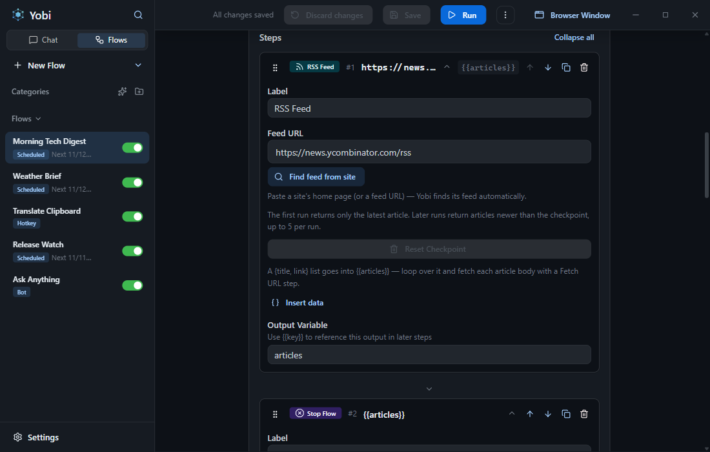
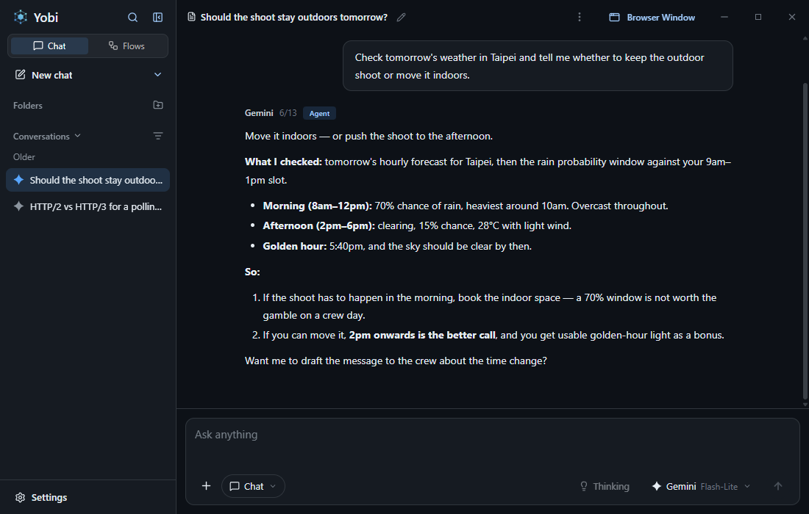
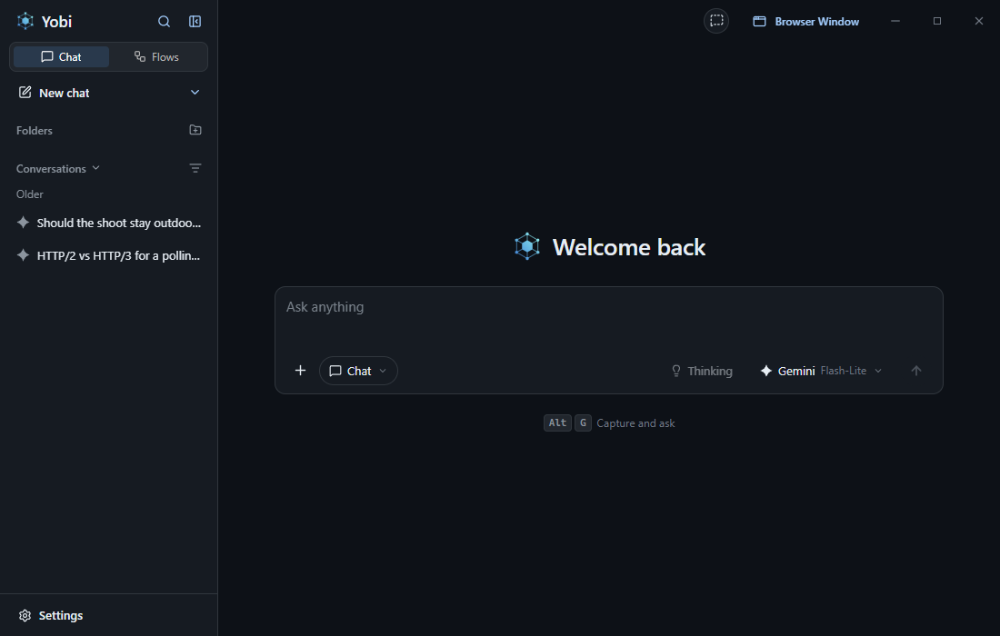
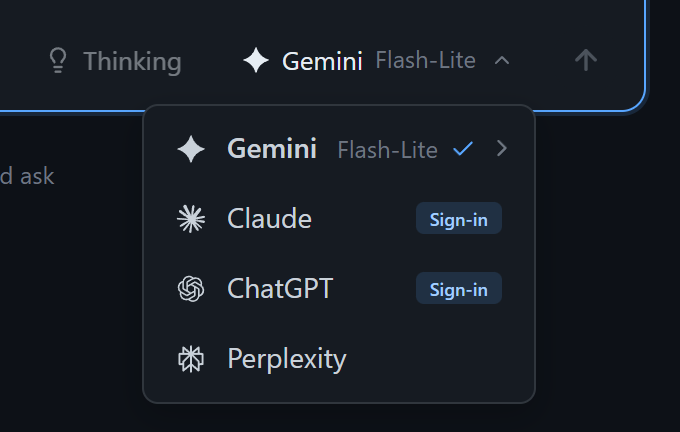
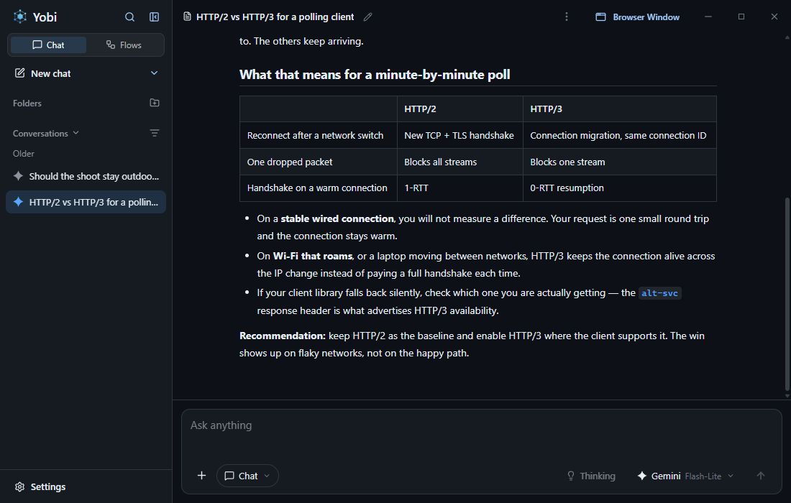
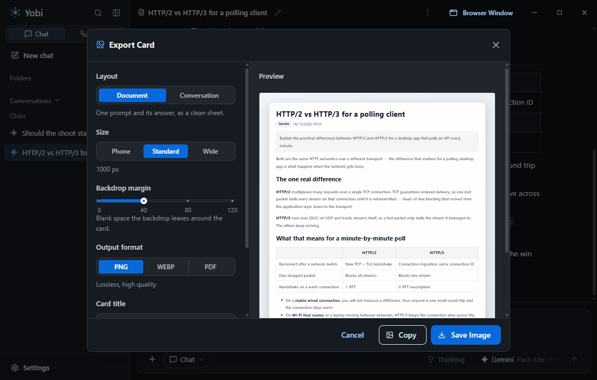

<div align="center">

# Yobi

**桌面 AI 工具：聊天、Agent 與自動化流程，預設不需 API 金鑰。**

[](LICENSE)
[](#開始使用)
[](https://apps.microsoft.com/detail/9nnx8prfstc9)
[](https://www.electronjs.org/)
[](https://github.com/WellWells/yobi/pulls)

**[English](README.md) · [简体中文](README.zh-CN.md) · [繁體中文](README.zh-TW.md)**

</div>

---

**Yobi** 把 AI 聊天、Agent 與自動化流程放在桌面上。你可以選取文字後按熱鍵提問，讓 Agent 查資料、使用工具，或把固定工作存成流程，按排程執行。也能透過 Telegram、LINE、Discord 或 Slack 使用這台電腦上的 AI 與流程。

預設操作 Gemini、Claude、ChatGPT、Perplexity 與 DeepSeek 的網頁版，不需 API 金鑰，也不產生 API 用量費；可用模型與額度仍依各家方案。選用自備金鑰（BYOK）時，費用與額度依該 API 服務計算。

流程在你的電腦上執行，AI 回答通常由外部服務產生。**排程與 Bot 需要電腦保持開機、未睡眠，並讓 Yobi 持續執行**；連網功能也需要網路。

<!-- demos:hero:start -->
<p align="center"></p>
<!-- demos:hero:end -->

---

## 能做什麼

- **聊天與書寫**：切換 AI 服務商與模型，改寫選取段落、翻譯回答或整段對話，匯出 Markdown、PDF 或圖片。
- **Agent**：用一句話交代工作，由 AI 搜尋、讀取資料、呼叫工具；也能使用你安裝的技能。操作確認的範圍見[安全與隱私](#安全與隱私)。
- **流程**：61 種步驟，以 `{{變數}}` 串接。從選單加入，或描述需求讓 AI 建立，再自行修改每一步。
- **連接器**：使用本機 LINE（Windows）、Thunderbird、信箱、行事曆、Notion、GitHub 與其他 MCP 服務。
- **連結與媒體**：讀取文章與貼文、分析留言或 Google 地圖評論，下載支援網站的影片、MP3 與字幕，也可請 Gemini 或 ChatGPT 產圖。
- **台灣查詢**：PTT、台鐵、高鐵、七個捷運系統與統一發票對獎。
- **介面語言**：英文、繁體中文、简体中文，另可放入[語言包](language/README.md)。

---

<!-- demos:start -->
## 實際操作

<table>
<tr>
<td width="33%" valign="top">
<a href="assets/demos/zh-TW/flow-build.webp"></a>
<br /><b>以文字描述建立流程</b>
<br /><sub>以一句話描述自動化需求，產生可直接執行、也可逐步修改的流程。</sub>
</td>
<td width="33%" valign="top">
<a href="assets/demos/zh-TW/writing.webp"></a>
<br /><b>改寫選取的段落</b>
<br /><sub>僅改寫回答中選取的段落，修改直接寫回 Markdown。</sub>
</td>
<td width="33%" valign="top">
<a href="assets/demos/zh-TW/telegram.webp"></a>
<br /><b>透過 Telegram 分析地點評論</b>
<br /><sub>傳送 Google 地圖連結給 Telegram Bot，由電腦端讀取評論並回傳分析。</sub>
</td>
</tr>
<tr>
<td width="33%" valign="top">
<a href="assets/demos/zh-TW/downloader.webp"></a>
<br /><b>從貼文連結下載影片</b>
<br /><sub>貼上貼文連結即可下載影片，也可針對貼文內容提問。</sub>
</td>
<td width="33%" valign="top">
<a href="assets/demos/zh-TW/notion.webp"></a>
<br /><b>匯入並編輯 Notion 頁面</b>
<br /><sub>匯入 Notion 頁面，以 AI 協助編輯後同步回 Notion。</sub>
</td>
<td width="33%" valign="top">
<a href="assets/demos/zh-TW/line.webp"></a>
<br /><b>查詢本機 LINE 對話內容</b>
<br /><sub>在本機 LINE 對話中搜尋指定內容，並整理成條列結果。</sub>
</td>
</tr>
<tr>
<td width="33%" valign="top">
<a href="assets/demos/zh-TW/rail.webp"></a>
<br /><b>查詢高鐵班次與票價</b>
<br /><sub>查詢高鐵與台鐵的班次及票價，資料取自營運單位。</sub>
</td>
</tr>
</table>
<!-- demos:end -->

---

## 流程

一條流程就是一串步驟，前一步的輸出經由 `{{變數}}` 傳給下一步：

```
排程       每天 09:00
    ↓
LINE      → {{chat}}      昨日至今的群組訊息
    ↓
問 AI     → {{summary}}   摘要，並挑出決議與待辦
    ↓
Telegram  送出 {{summary}}
```

也可以直接描述需求，讓 AI 組出整條流程，每一步之後都能改：

> *「每個平日早上 8 點，摘要我的 RSS 並送到 Telegram。」*

內建 30 條範本可以直接改：有的按排程、有的用熱鍵處理選取的文字、有的在檔案放進資料夾時執行、有的用聊天或 Bot 指令觸發。

**步驟：**

- **取得資料** — 網頁、RSS、HTTP API、YouTube 文字稿與訂閱頻道新影片、網路搜尋與深度研究、Google 地圖評論、LINE 對話、Telegram 群組、X 貼文／回覆／趨勢、新信件、行事曆、股票、匯率、天氣、空氣品質、農民曆
- **台灣** — PTT 看板、統一發票對獎
- **使用連接器** — 呼叫已加入連接器的任一工具，例如 Notion 或 Jira
- **擷取清單** — 在網頁上點一則標題，Yobi 找出其他項目
- **操作瀏覽器** — 開分頁、點擊、填表單、擷圖
- **詢問 AI** — Gemini、Claude、ChatGPT、Perplexity、DeepSeek 或 BYOK
- **送出結果** — Telegram、LINE、Discord、Slack、寄信、檔案、PDF、圖片、分享連結、剪貼簿、通知
- **執行程式** — 程式、JavaScript、shell、系統與電源控制
- **流程控制** — 迴圈、條件、延遲、提前停止、「有變化才通知」

流程是單純的 `.json` 檔。匯出時不含你填的變數值與 Bot 帳號 ID；匯入前會先列出它會取用什麼。

流程按「儲存」才寫入，啟用後依觸發條件執行；可在版本紀錄查看與還原舊版。**已設定的流程不會在每個動作前再次詢問**，請先檢查寄送、寫檔、刪除與系統指令。Bot 觸發的連接器步驟只允許讀取，不能修改遠端資料。

---

## 連接器

**這台電腦上：**

- **LINE**（Windows）— 從執行中的 LINE 電腦版列出聊天室、搜尋訊息、讀取對話，也能以你的身分傳送，每次都先問你。不會標成已讀。流程用 **LINE 訊息** 步驟。
- **Thunderbird** — 搜尋、閱讀、撰寫、回覆、轉寄、歸檔郵件，以及行事曆、工作與聯絡人。需要 Thunderbird MCP 擴充功能（**設定 → 連接器**有連結）。流程寄信用 **寄送 Email** 步驟。

**信箱。** 在**設定 → 連接器 → 信箱**加入信箱：Gmail、Yahoo、iCloud 用應用程式密碼，Outlook、Hotmail、Microsoft 365 用**用 Microsoft 登入**，其他填 IMAP／SMTP 伺服器。Agent 會一次搜尋全部信箱，可以讀信、存附件、寫草稿、回覆、寄出、整理與丟垃圾桶；寄出與丟垃圾桶每次都會問。流程用 **讀新信** 與 **寄送 Email**。

**行事曆。** 在**設定 → 連接器**加入 .ics 訂閱或 CalDAV 帳號。訂閱只能讀取；CalDAV 可新增、修改與刪除行程。

**免費翻譯。** 預設開啟，Agent 可透過 Microsoft 翻譯文字與字幕檔，不需翻譯 API 金鑰。字幕支援 SRT、VTT、SBV、ASS、SSA、LRC，保留時間碼並另存譯文。請提供電腦上的檔案路徑；拖曳附件不會直接交給這個工具。內容會送給 Microsoft，逐行翻譯不會參考前後文，結果適合當草稿；Agent 本身仍會使用所選模型的額度。

**通用網頁讀取。** 預設開啟。給一個連結，Agent 就讀到內文本身：新聞、部落格、文件、論壇，以及 Reddit、X、LinkedIn、PTT 這類貼文，不含選單與相關文章。把連結貼到聊天或傳給 Bot 就會用到，Google 新聞的連結會跟到原文。只傳一個連結給 Bot 時，內容完整就直接轉主文，不用等模型，下面有「分析」按鈕；連結加了字或讀不完整才交給 Agent。只讀公開內容：要登入才看得到的頁面（例如知乎）讀不到，要訂閱的文章只讀得到公開的開頭。

**台灣。** 台灣的使用者預設開啟，資料都讀自各營運單位的網站：

- **PTT** — 找看板、依推文數或關鍵字列出文章、讀文章與推文。流程用 **PTT 看板** 步驟。
- **台灣鐵路** — 台鐵、高鐵的時刻與票價，以及七個捷運系統的路線規劃、票價、下一班與營運狀態。

**X（推特）。** 搜尋貼文、看趨勢、讀帳號最新貼文與貼文底下的回覆。在**設定 → 連接器**開啟並登入（搜尋與趨勢需要登入）；訊息裡提到 X 或推特，Agent 就會去 X 查。流程用 **X 追蹤**、**X 貼文與回覆**、**X 熱門趨勢**。未登入只看得到每個帳號最新幾則與少數熱門回覆，也沒有趨勢。

**Instagram、Facebook、Threads、bilibili。** 各有連接器與登入入口，用來讀取貼文或影片資料。能讀到多少依網站與帳號權限而定；Instagram、Facebook 的限時動態需要登入，bilibili 的字幕也需要登入。

**雲端服務。** 連接一次（多數要登入，GitHub 貼 token，查資料類不用設定）：

- **工作** — Notion · Linear · Asana · Atlassian（Jira 與 Confluence）· Airtable · Dropbox · Zapier
- **開發** — GitHub · Sentry · Vercel · Netlify · Supabase · Neon · Cloudflare
- **設計** — Figma · Webflow · Wix
- **商務** — Stripe · Square · PayPal · Intercom
- **查資料** — Context7 · DeepWiki · Microsoft Learn · Cloudflare Docs · Hugging Face

其他 MCP 服務可在**設定 → 連接器**加入支援的 HTTPS 端點。雲端目錄的服務需要自行加入與連線；通用網頁讀取、免費翻譯預設開啟，PTT 與台灣鐵路依地區開啟。Agent 的變更操作依風險決定是否確認；**永遠允許這個伺服器**不會略過寄送與刪除的確認。

---

## 觸發方式

| 觸發 | 適用情境 |
| ---- | -------- |
| **排程** | 每個平日早上送來的摘要 |
| **全域熱鍵** | 在任何 App 按下自訂按鍵；流程拿得到選取的文字 |
| **Bot 訊息** | 傳給 Telegram、LINE、Discord 或 Slack Bot 的 `/指令`；可指定哪些已配對帳號能用 |
| **斜線指令** | 在 App 輸入框輸入 `/你的流程` |
| **新檔案** | 指定資料夾裡每存入、下載或搬進一個檔案，寫完就執行一次 |
| **系統事件** | Yobi 啟動、電腦從睡眠喚醒、螢幕鎖定或解鎖（鎖定與解鎖限 Windows 與 macOS） |

---

## 聊天與 Agent

向 `/agent` 交代工作，它可規劃、搜尋、呼叫當次可用的工具並檢查結果，也能建立或修改流程，供之後使用。由 Agent 建立的新流程存檔時是停用的。哪些操作需要確認，見[安全與隱私](#安全與隱私)。

在聊天中，從輸入框下方的模式選單選 **Agent**，或在同一個選單開啟**網頁**或連接器。全部關閉時就是一般對話，存成可重新開啟的 Markdown 檔。需要查資料才答得出的問題（天氣、股價、匯率）仍會交給 Agent，只限那一則。

`Shift+Tab` 切換服務商與模型，`Ctrl+G` 用外部編輯器寫草稿。回答會渲染 Mermaid 與數學式，可匯出 PNG、WebP、PDF；整段對話可做成端對端加密的分享連結。

選取回答中的文字可改寫或翻譯，也可逐段編輯 Markdown。回答的譯文可與原文對照；**翻譯整個對話**會建立一份新對話，保留原檔。**轉成繁體**在本機用 OpenCC 處理，不會送出請求。

連上 Notion 後，可從聊天側欄匯入頁面，在 Yobi 編輯或請**書寫助理**修改。文件會標出與 Notion 的差異，按**同步到 Notion**才送出；遇到兩邊都改過的內容，先處理衝突。表格、資料庫與部分複雜區塊目前不能直接編輯。

個人化記憶保存關於你的短句，例如所在城市、偏好的回答方式。AI 記下時會在回答下方顯示，可按**復原**。在**設定 → 個人化記憶**可以新增、編輯、刪除；**整理**會建議合併與刪除，只套用你勾選的項目。

---

## 技能

技能是 Agent 處理某類工作時遵循的指示，格式為 `SKILL.md`，可附腳本與參考資料。在**設定 → 技能**管理：

- 從資料夾、GitHub、`.zip`、`.skill`、`.md` 或這台電腦上其他 AI 工具的技能匯入，先預覽再安裝。
- 自己撰寫、請 AI 起草，或從聊天選單選**存成技能**。草稿經你儲存才成為技能。
- **檢查**會在本機檢查檔案並試跑支援的腳本範例；**試試看**則用所選模型實際處理一句請求。檢查通過不代表內容一定正確。
- 隨 App 提供的內建技能可關閉、更新或還原；從 GitHub 匯入的技能可檢查新版，更新前仍需預覽。

內建的**台灣商品比價**可從購物連結或商品型號比較不同商店的價格，需要開啟**網頁**。結果附上能查證的價格來源；歷史價格只列查得到的紀錄，不保證是全市場或歷來最低價。

技能可匯出成 `.zip`。格式相同不代表所有工具都能直接使用：外部程式要另行安裝，其他 AI 工具專用的設定不會在 Yobi 執行。技能的 JavaScript 在限制讀寫與連網的沙盒裡執行；外部指令依[操作確認規則](#安全與隱私)處理。

---

## 連結、下載與產圖

貼上支援的連結，可直接顯示內容或下載選單；加上問題則交給 Agent。自動辨識的網站可在**設定 → 連結與下載**逐一開關，預設值依介面語言與地區而定。

- **貼文**：X、Threads、Instagram、Facebook、TikTok、Reddit、微博，以及台灣使用者的 PTT、Dcard。可讀內文、取得可用的媒體，並分析讀到的留言；留言可能只是抽樣，限時動態不提供留言分析。
- **影片與音訊**：YouTube、bilibili、Vimeo、SoundCloud 與未加密的 `.m3u8` 串流。可用畫質、MP3、字幕與分析依網站及該支內容而定；SoundCloud 以音訊為主，整個播放清單與直播不支援，一次下載一支。
- **地點評論**：貼 Google 地圖連結分析讀到的評論，也可請 Agent 查 Agoda 飯店評論；結果受可取得的評論範圍限制。
- **產圖**：直接描述要畫的內容，可指定 Gemini 或 ChatGPT，未指定時用 Gemini；Agent 也能依查到的資料請網頁版產圖。BYOK 不直接產圖，仍需可用的網頁服務與額度。

下載器需要的 yt-dlp、FFmpeg 可由 App 安裝。檔案預設存到「下載／Yobi」，預設保留三天，可在設定調整。Bot 能否直接收到檔案，依平台與帳號權限、大小限制而定；LINE 官方帳號與 LINE PC 的能力不同。網站可能要求登入或驗證，也可能改版造成讀取失敗；不支援解除 DRM。

---

## 開始使用

**1. 安裝：**

```bash
brew install --cask wellwells/tap/yobi   # macOS（Intel 與 Apple Silicon）
```

```powershell
# Windows：Microsoft Store 版，由 Store 更新
winget install 9NNX8PRFSTC9

# Windows：GitHub 版，會自動更新（貼到 PowerShell）
irm https://github.com/WellWells/yobi/releases/latest/download/install.ps1 | iex
```

或從 [Microsoft Store](https://apps.microsoft.com/detail/9nnx8prfstc9)、[GitHub Releases](https://github.com/WellWells/yobi/releases)（Windows 安裝檔、macOS DMG）下載。GitHub 版本未簽章：用瀏覽器下載 Windows 安裝檔時請選**其他資訊 → 仍要執行**；macOS 見[發行說明](https://github.com/WellWells/yobi/releases)。Windows 開啟「智慧型應用程式控制」時會封鎖 GitHub 版，請改用 Store 版。

**2. 試一下：**

1. 預設的 Gemini 與 Perplexity 不用帳號。要用 Claude、ChatGPT 或 DeepSeek，到**設定 → AI 模型**按旁邊的**登入**。
2. 在任何 App 選取一段文字。
3. 按 **`Alt+G`**（macOS 為 `⌘⌃G`）。答案會複製到剪貼簿，對話存在**聊天**裡。

**`Alt+J`**（macOS 為 `⌘⌃J`）則是框選螢幕的一塊，再對它提問。

接著到**流程 → 範本**。

<details>
<summary><b>從原始碼執行</b>（Node.js 24+）</summary>

```bash
git clone https://github.com/WellWells/yobi.git
cd yobi
npm install   # Windows 沒裝 Visual Studio 時：npm install --ignore-scripts
npm run dev
```
</details>

---

## 畫面截圖

| 流程編輯器 | `/agent` |
| :--------: | :------: |
|  |  |
| 抓取、AI 摘要，按排程送到 Telegram | 給它目標，它自己挑工具 |

| 聊天 | 模型選擇 |
| :--: | :------: |
|  |  |
| 透過 AI 的網頁對話 | 切換服務商與模型 |

| 對話紀錄 | 匯出 |
| :------: | :--: |
|  |  |
| 對話存成 Markdown 檔，可重新開啟 | PNG、WebP、PDF，樣式可自訂 |

---

## 用手機操控

接上 Telegram、LINE、Discord 或 Slack Bot，就能從手機用你的 AI 與流程。回覆與流程由電腦上的 Yobi 處理，電腦關機、睡眠或 Yobi 結束時就無法回應。Telegram 的設定方式：

1. 向 [@BotFather](https://t.me/BotFather) 建立 Bot，複製 token。
2. 在**設定 → Bot 整合**開啟**啟用 Telegram Bot**，把 token 貼到 **Bot Token**，按**儲存 Token**。
3. 按**建立配對碼**，對 Bot 傳 `/start <配對碼>`，或按**開啟 Telegram**。

**LINE PC（Windows）：** 使用自己的 LINE 帳號，不需建立官方帳號或架設 webhook。在**設定 → 連接器**開啟本機 LINE，再到**Bot 整合**啟用 LINE PC；LINE 電腦版需開啟並登入。在群組或你發出的 1 對 1 訊息以「Yobi」開頭，例如「Yobi 明天會下雨嗎」。回答用你的帳號送出，標示 `[Yobi]`；群組中的其他人首次使用會請你允許，1 對 1 的對方訊息不會觸發。可回傳圖片、影片與檔案。

**LINE 官方帳號：** 在 LINE Developers Console 建立 Messaging API channel，把 **Channel access token** 與 **Channel secret** 填進 LINE 卡片，再開一條通道連到 Yobi 的本機 webhook（卡片上有 `cloudflared` 指令）。配對時按**產生配對碼**，把連結傳給對方。這個模式不能直接上傳電腦裡的檔案，下載結果可能只存到電腦。

**Discord 與 Slack** 由這台電腦主動連出，不用開通道。Discord 在 Developer Portal 建立應用程式、貼上 bot token；Slack 用卡片上的設定檔建立 App、貼上兩把 token。配對方式與 LINE 相同。

沒配對的人私訊 Bot 就是申請加入，在**設定 → Bot 整合**允許或封鎖；Telegram 與 LINE 也會傳一張有**允許**與**封鎖**的卡片給你。

| 指令 | 功能 |
| ---- | ---- |
| `/gemini` · `/claude` · `/gpt` · `/pplx` | 指定服務商回答；每把自備金鑰與金鑰群組也有自己的指令（名稱可自訂） |
| `/search` | 搜尋網路並附來源（需要**網路搜尋**權限） |
| `/new` | 開新對話（閒置 6 小時也會自動開新的） |
| `/help` | 列出能用的指令（LINE） |
| `/status` | 查看工作佇列（Telegram，管理員） |
| `/restart` | 重新啟動 Yobi（Telegram，管理員） |
| `/users` · `/invite` · `/groups` | 處理加入申請與權限、發會過期的邀請連結、決定哪些群組能用 Bot（Telegram 管理員；LINE 只有你本人） |

一般訊息由 Bot 的**預設模型**處理，要不要查資料、用工具由 AI 判斷；支援的純連結可能直接走內建讀取或下載，不經模型。說「轉成 PDF」之類的話，支援回傳檔案的平台可將答案做成 PDF、PNG 或 WebP。一般配對只開放聊天與模型指令；其他權限逐一帳號開：**Agent**、**網路搜尋**、**讀取這台電腦**、**執行指令**（每次都要同意）、連接器、**管理員**（僅 Telegram）。LINE PC 首次連線會自動將登入帳號設為本人，執行指令仍需另行授權。

你和管理員也能在私訊請 Bot 建立或修改流程，例如「每 10 分鐘檢查省錢版，推文超過 20 的通知我」。存檔前 Bot 會先問你。會操作電腦的流程，以及管理員建立、會讀你的資料或代替你動作（存檔、寄信、在你登入的瀏覽器開網頁）的流程，會存成停用，等你在電腦上確認。

流程的 **Bot** 觸發器可以加你自己的指令（例如 `/my_cmd`），每個平台都能用。指令後的文字會帶進流程，可開放給**所有已配對的人**或**指定的人**。

---

## 設定

AI 模型 · AI 回應 · 個人化記憶 · 連接器 · 技能 · Bot 整合 · 一般 · 外觀 · 通知 · 連結與下載 · 匯出 · 鍵盤快速鍵 · 統計 · 備份與還原。

**BYOK：** 在**AI 模型 → 自備金鑰（API）**按**新增金鑰**，選服務商（OpenAI、Anthropic、Google Gemini、OpenRouter、DeepSeek 等），其他端點（包括本機伺服器）選 **OpenAI-compatible**。金鑰會出現在聊天的模型選單、流程的 AI 步驟，也會變成一個 Bot 指令。**金鑰群組（輪流使用）**讓多把金鑰輪流用，某把失敗就換下一把。附件能力依服務商類型而定，支援圖片的金鑰也不等於能上傳 PDF 或其他文件。

**備份與還原**可將設定（含加密的金鑰與密碼）、流程、Markdown 對話、記憶、技能與版本紀錄打包成一個 .zip，備份與還原時可挑項目。金鑰與密碼只能在原本那台裝置還原。備份不包含下載的媒體、聊天圖片快取或網站登入狀態；想長期保留的圖片與附件請另存。

---

## Yobi 怎麼運作

預設的 AI 請求走服務商的**網頁**：Yobi 在內建瀏覽器輸入提示詞，再從頁面讀回答案。Gemini 與 Perplexity 可不登入使用；Claude、ChatGPT 與 DeepSeek 需要登入。Yobi 本身不執行 AI 模型；選用 BYOK 時改呼叫指定端點，也可連到你另外架設的本機模型。

這是非官方的網頁自動化，登入要求、模型、額度與網頁介面都可能變動。遇到驗證時可能需要你在瀏覽器視窗完成操作；Yobi 不代解 CAPTCHA，也不輪換 IP。網站改版或限制自動化時，功能可能暫時無法使用。

各家對自動化存取的規定不同：[OpenAI 使用條款](https://openai.com/policies/terms-of-use/)禁止自動擷取資料或輸出；[Anthropic 消費者條款](https://www.anthropic.com/legal/consumer-terms)限制未經允許、非 API 的自動化存取。使用前請確認所選服務的現行條款與帳號限制，不要把能操作網頁視為服務商已允許這種用法。

---

## 安全與隱私

- **送給 AI 的內容。** 提示詞、對話前文、使用到的附件與工具結果會送到所選 AI 的網頁或 BYOK 端點；啟用的個人化記憶與回答偏好也可能一併送出，適用該服務商的隱私權政策。本機執行不代表資料不會連外。
- **沒有伺服器、沒有遙測。** Yobi 沒有帳號、沒有分析追蹤。對話、流程、記憶與匯出檔都是你硬碟上的普通檔案。
- **其他連外內容。** 搜尋字詞送到 Brave Search 與 Bing，兩者都不能用時改用 DuckDuckGo。Microsoft 翻譯會收到待翻譯的內容。連接器會與啟用或加入的服務通訊；GitHub 技能會檢查新版。分享內容在 App 內加密後上傳到 PrivateBin（預設 privatebin.net，可改用自己的），金鑰在連結的 `#fragment`；拿到完整連結的人即可解密。非 Store 版啟動時會向 GitHub 檢查 Yobi 更新。
- **Agent 的檔案範圍。** 內建讀檔工具限輸出資料夾、文件、下載、桌面與聊天媒體；寫檔限輸出資料夾，這個範圍內的寫入不逐次確認。送進模型的工具內容會遮罩可辨識的金鑰與 token，不能保證所有敏感資訊都被辨識。
- **Agent 的操作確認。** 儲存或修改流程、需要確認的連接器變更，以及 shell 指令會先詢問；寄送與刪除類的連接器操作每次確認，部分可復原的操作可直接執行。你在桌面確認框選過**以後直接執行**的程式、動作與選項可免問；新選項、其他指令與 Bot 指令仍會詢問，可在**設定 → 技能**撤銷。核准的 shell 指令以目前使用者的權限執行，不受前述讀寫資料夾限制。
- **Bot 的權限。** 在**設定 → Bot 整合**依帳號與群組授權。個人資料、系統指令與變更操作有較嚴格的限制，部分公開資料連接器可在群組使用；LINE PC 本人的權限也有例外。Agent 從 Bot 修改連接器資料，僅限本人私訊並確認後執行。流程則依已儲存的設定執行，不沿用 Agent 的逐次確認方式。
- **憑證加密。** Bot token、信箱密碼與 Microsoft 登入、API 金鑰、連接器登入與 LINE 資料庫金鑰，都以作業系統的金鑰儲存區（Electron `safeStorage`）加密。

---

## 延伸閱讀

- [Yobi：用內建瀏覽器操作網頁版 AI 的自動化工具，打造專屬 Agent](https://wellstsai.com/post/yobi-free-ai-automation/) — 功能與安裝
- [用 Telegram Bot 自動收 RSS 摘要：不用 API Key 的完整教學](https://wellstsai.com/post/telegram-bot-rss-ai-digest/) — 一條流程從頭做到尾
- [免費 LLM API 金鑰申請教學：Gemini、OpenRouter 額度實測](https://wellstsai.com/post/free-ai-api-key/) — 想用 BYOK 看這篇

---

## 開發

```bash
npm run dev         # 開發模式；改了主程序後按 Enter 重啟 Electron
npm run typecheck   # TypeScript 型別檢查
npm run i18n:check  # 比對 language/*.json 與原始碼；會刪掉沒用到的 key
npm run build:win   # Windows（NSIS 安裝檔）
npm run build:mac   # macOS（DMG）
```

**技術堆疊：** Electron · React + TypeScript · Mantine · Zustand · Vite + electron-builder · grammY · LINE Bot SDK · MCP SDK

---

## 參與貢獻

歡迎 issue 與 PR，送出前確認 `npm run typecheck` 通過。使用者看得到的文字放在 `language/*.json`，en-US、zh-TW、zh-CN 都要補；新增語言見 [language/README.md](language/README.md)。較大的改動請先開 issue。

---

## 授權

[MIT](LICENSE)。授權未涵蓋的部分見 [NOTICE](NOTICE)。

---

<div align="center">

**[回報問題](https://github.com/WellWells/yobi/issues) · [功能建議](https://github.com/WellWells/yobi/issues) · [討論區](https://github.com/WellWells/yobi/discussions)**

</div>
