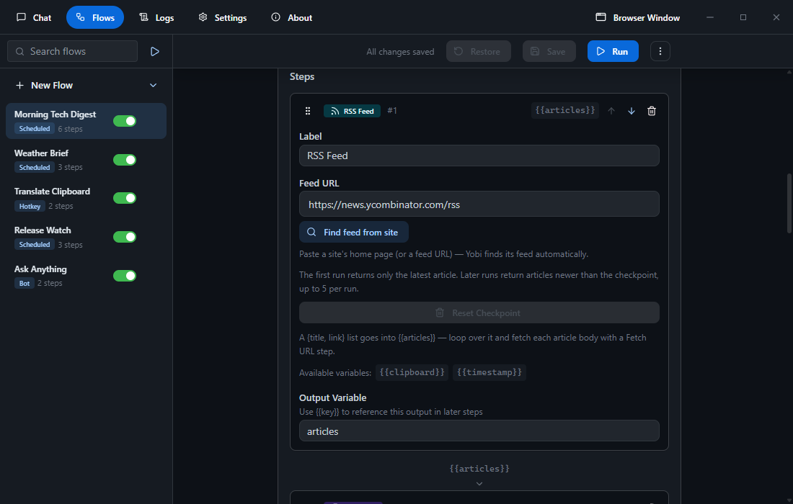
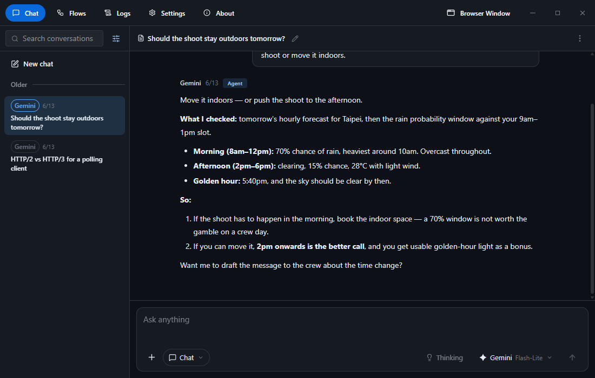
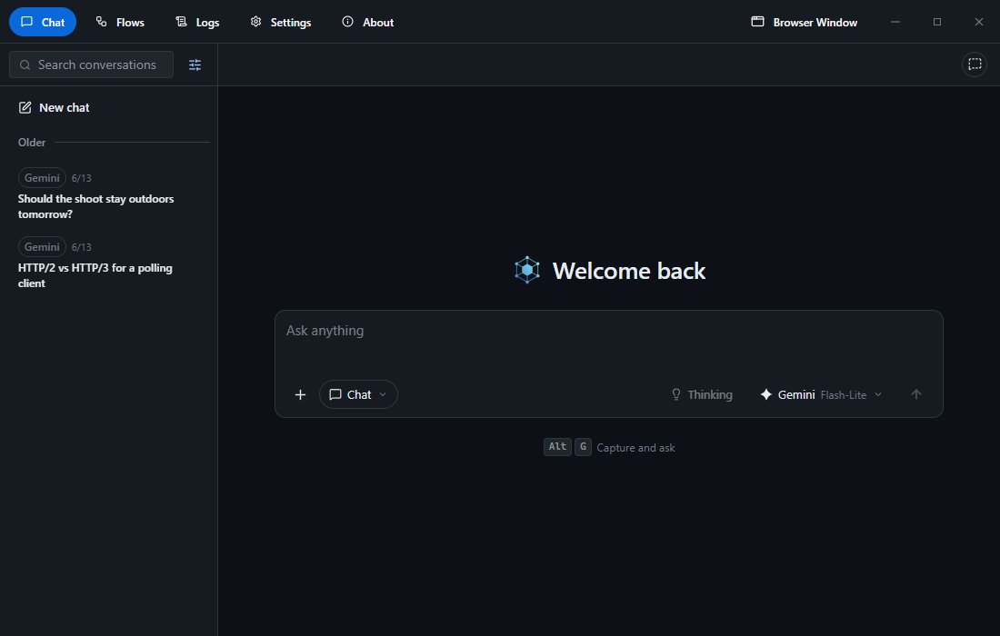
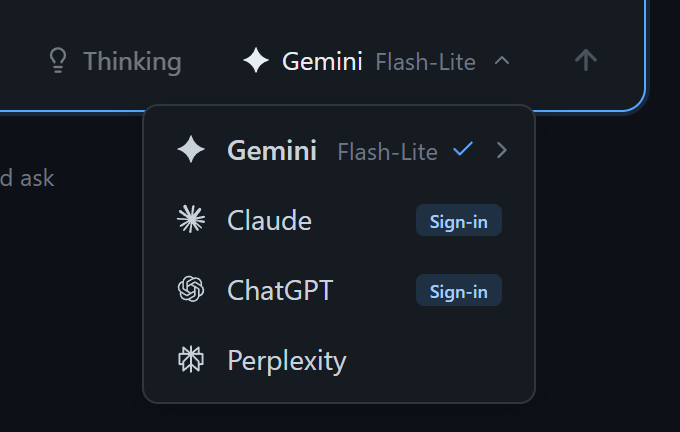
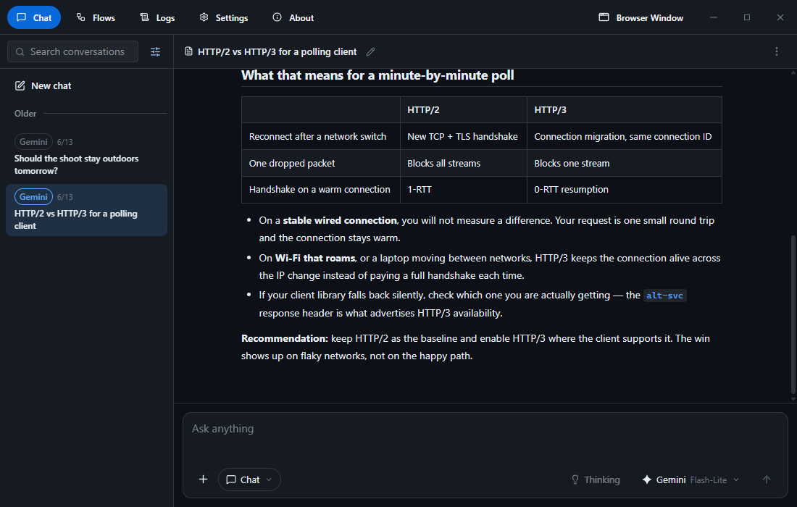
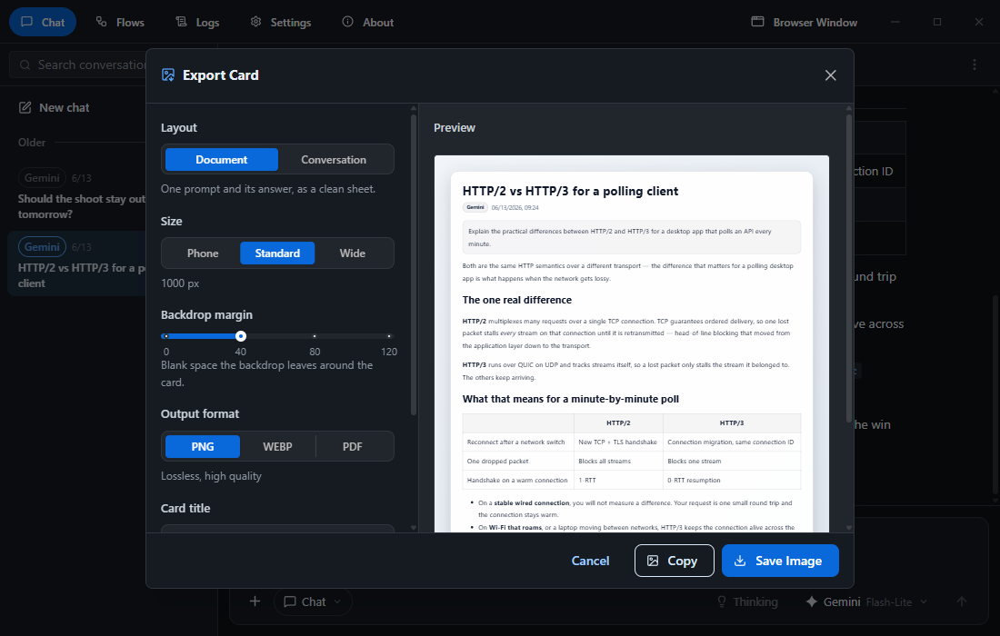

<div align="center">

# Yobi

**桌面 AI 自動化。流程在本機執行，可操作這台電腦上的應用程式，AI 不需 API 金鑰。**

[](LICENSE)
[](#開始使用)
[](https://apps.microsoft.com/detail/9nnx8prfstc9)
[](https://www.electronjs.org/)
[](https://github.com/WellWells/yobi/pulls)

**[English](README.md) · [简体中文](README.zh-CN.md) · [繁體中文](README.zh-TW.md)**

</div>

---

**Yobi** 是一套在桌面執行的流程引擎。把資料、AI 與動作串成自動化，再以排程、全域熱鍵、傳給 Telegram、LINE、Discord 或 Slack Bot 的指令、App 內的斜線指令、資料夾裡出現新檔案時觸發，或在 Yobi 啟動、電腦喚醒、螢幕鎖定或解鎖時執行。因為它執行在你的電腦上而非伺服器，流程能取用雲端工具接觸不到的對象：本機的 LINE（Windows）、你的檔案、shell，以及一個真正的瀏覽器。AI 步驟驅動的是服務商自家的網頁，因此不需要 API 金鑰，也沒有按 token 計費的帳單。

<!-- demos:hero:start -->
<p align="center"></p>
<!-- demos:hero:end -->

---

## 為什麼用 Yobi

| 功能 | 說明 |
| ---- | ---- |
| **無程式碼流程** | 60 種步驟，以 `{{變數}}` 串接。從選單加入、拖曳調整順序，也可以描述需求讓 AI 生成。 |
| **在本機執行** | 流程可讀取本機的 LINE（Windows），並取用你的檔案、shell 與瀏覽器視窗；Agent 另可操作 Thunderbird。無須架設。 |
| **不需 API 金鑰** | AI 步驟驅動服務商的網頁，而非付費 API。想用自己的金鑰再開 BYOK 即可。 |
| **會執行動作的代理** | 把聊天切到 **Agent**（或輸入 `/agent`）並交給它一個目標：它自行挑選工具，變更任何東西之前會先徵詢你。傳給 Telegram、LINE、Discord 或 Slack Bot 的訊息也由 Agent 處理，可用的工具依你給每個帳號的權限而定。 |
| **連接器** | 給 Agent 使用：Notion、GitHub、Figma、Stripe 等服務，或貼上任何 MCP 伺服器網址。內建本機的 LINE 與 Thunderbird、你的信箱、X、PTT，以及台灣的鐵路與捷運。 |
| **六種觸發方式** | 排程、全域熱鍵、傳給 Bot 的指令、App 內斜線指令、資料夾裡出現新檔案、系統事件（Yobi 啟動、電腦喚醒、螢幕鎖定或解鎖）。一條流程可同時使用多種。 |
| **主流 AI 全都有** | Gemini、Claude、ChatGPT、Perplexity。Gemini、Claude、ChatGPT 可選模型與思考強度；Gemini 與 Perplexity 不登入也能用。 |
| **沒有中間人** | Yobi 自己不執行任何伺服器。提示詞直接送往你選的 AI 網站；其他資料只在用到會連網的功能（網路搜尋、Bot、分享連結、連接器等）時才會離開這台電腦。 |
| **多語系** | 內建英文、繁體中文、简体中文，另可放入語言包擴充（[說明](language/README.md)）。 |

---

<!-- demos:start -->
## 實際操作

<table>
<tr>
<td width="33%" valign="top">
<a href="assets/demos/zh-TW/flow-build.webp"></a>
<br /><b>以文字描述建立流程</b>
<br /><sub>以一句話描述自動化需求，產生可直接執行、也可逐步修改的流程。</sub>
</td>
<td width="33%" valign="top">
<a href="assets/demos/zh-TW/writing.webp"></a>
<br /><b>改寫選取的段落</b>
<br /><sub>僅改寫回答中選取的段落，修改直接寫回 Markdown。</sub>
</td>
<td width="33%" valign="top">
<a href="assets/demos/zh-TW/telegram.webp"></a>
<br /><b>透過 Telegram 分析地點評論</b>
<br /><sub>傳送 Google 地圖連結給 Telegram Bot，由電腦端讀取評論並回傳分析。</sub>
</td>
</tr>
<tr>
<td width="33%" valign="top">
<a href="assets/demos/zh-TW/downloader.webp"></a>
<br /><b>從貼文連結下載影片</b>
<br /><sub>貼上貼文連結即可下載影片，也可針對貼文內容提問。</sub>
</td>
<td width="33%" valign="top">
<a href="assets/demos/zh-TW/notion.webp"></a>
<br /><b>匯入並編輯 Notion 頁面</b>
<br /><sub>匯入 Notion 頁面，以 AI 協助編輯後同步回 Notion。</sub>
</td>
<td width="33%" valign="top">
<a href="assets/demos/zh-TW/line.webp"></a>
<br /><b>查詢本機 LINE 對話內容</b>
<br /><sub>在本機 LINE 對話中搜尋指定內容，並整理成條列結果。</sub>
</td>
</tr>
<tr>
<td width="33%" valign="top">
<a href="assets/demos/zh-TW/rail.webp"></a>
<br /><b>查詢高鐵班次與票價</b>
<br /><sub>查詢高鐵與台鐵的班次及票價，資料取自營運單位。</sub>
</td>
</tr>
</table>
<!-- demos:end -->

---

## 流程

一條流程就是一串步驟，前一步的輸出經由 `{{變數}}` 成為下一步的輸入：

```
排程       每天 09:00
    ↓
LINE      → {{chat}}      昨日至今的群組訊息
    ↓
問 AI     → {{summary}}   摘要，並挑出決議與待辦
    ↓
Telegram  送出 {{summary}}
```

不必自行組裝。描述你要的結果，AI 會用下面這些步驟組出整條流程，每一步之後仍可修改：

> *「每個平日早上 8 點，摘要我的 RSS 並送到 Telegram。」*

上面那條也內建為範本，共有 28 條範本可以直接拿來改：一部分按排程執行，一部分按熱鍵處理你選取的文字，一部分用聊天或傳給 Bot 的指令觸發。

**步驟依類型：**

- **取得資料** — 網頁、RSS、HTTP API、YouTube 文字稿與訂閱頻道的新影片、網路搜尋與深度研究、Google 地圖評論、LINE 對話、Telegram 群組訊息、X 貼文、回覆與熱門趨勢（趨勢需登入 X）、PTT 看板、新信件、你的行事曆、即時股票 / 外匯 / 天氣 / 空氣品質、農民曆與統一發票對獎
- **使用連接器** — 呼叫你加入的連接器的任一工具，例如 Notion 或 Jira
- **擷取清單** — 在真實網頁上點一則標題，Yobi 推算出整份清單的選擇器
- **操作瀏覽器** — 開分頁、點擊、填表單、擷圖
- **詢問 AI** — Gemini、Claude、ChatGPT、Perplexity，或 BYOK
- **送出結果** — Telegram、LINE、Discord、Slack、從你自己的信箱寄信、檔案、PDF、圖片或分享連結、剪貼簿、桌面通知
- **執行程式** — 程式、JavaScript、shell，以及系統與電源控制
- **流程控制** — 迴圈、條件、延遲、提前停止，以及「有變化才通知」

流程是單純的 `.json` 檔。可匯出分享（不含你填的變數值與 Bot 帳號 ID）；匯入時會先列出它會取用什麼。

---

## 連接器

**這台電腦上。** 以下兩個連接的是本機安裝的應用程式，不經過雲端帳號：

- **LINE**（Windows）— 列出聊天室、搜尋訊息、取出某段對話，讀的是執行中的 LINE 電腦版。不會送出任何內容給 LINE，也不會將訊息標示為已讀。流程用 **LINE 訊息** 步驟讀取。
- **Thunderbird** — 搜尋與閱讀郵件、撰寫、回覆、轉寄、歸檔，以及行事曆、工作與聯絡人。需要 Thunderbird MCP 擴充功能，**設定 → 連接器**有下載連結。這是給 Agent 用的；流程寄信用 **寄送 Email** 步驟。

**信箱。** 在**設定 → 連接器 → 信箱**加入一個或多個信箱：Gmail、Yahoo、iCloud 用應用程式密碼，Outlook、Hotmail、Microsoft 365 用**用 Microsoft 登入**，其他信箱填 IMAP 與 SMTP 伺服器。Agent 會一次搜尋全部信箱，可以讀信、存附件、寫草稿、回覆、寄出、整理與移到垃圾桶；寄出與移到垃圾桶每次都會問你。流程用 **讀新信** 步驟收信、**寄送 Email** 寄信。密碼與登入只存在這台電腦。

**台灣。** 內建，台灣的使用者預設開啟：**PTT**（找看板、依推文數或關鍵字列出文章、讀文章與推文）與**台灣鐵路**（台鐵與高鐵的時刻與票價，以及七個捷運系統的路線規劃、票價、下一班與營運狀態），都是讀各營運單位自己的網站。流程用 **PTT 看板** 步驟。

**X（推特）。** 內建：搜尋貼文、看熱門趨勢、讀帳號最新貼文與貼文底下的回覆。在**設定 → 連接器**開啟並登入（搜尋與趨勢需要登入）；之後訊息裡提到 X 或推特，Agent 就會到 X 上查。流程用 **X 追蹤**、**X 貼文與回覆**、**X 熱門趨勢** 步驟，共用同一個登入。未登入時每個帳號只看得到最新幾則貼文、每則只有少數熱門回覆，**X 熱門趨勢** 也無法使用。

**雲端服務。** 連接一次（多數要登入，GitHub 要貼 token，查資料類不需設定），Agent 就能使用該連接器的工具：

- **工作** — Notion · Linear · Asana · Atlassian（Jira 與 Confluence）· Airtable · Dropbox · Zapier
- **開發** — GitHub · Sentry · Vercel · Netlify · Supabase · Neon · Cloudflare
- **設計** — Figma · Webflow · Wix
- **商務** — Stripe · Square · PayPal · Intercom
- **查資料** — Context7 · DeepWiki · Microsoft Learn · Cloudflare Docs · Hugging Face

清單以外只要支援 MCP 也能加入：貼上網址即可。在**設定 → 連接器**啟用，該頁也會帶你完成各連接器所需的設定。啟用前一律不會運作。任何會寫入的操作都會先問你；按**永遠允許這個伺服器**可略過修改類的確認，但寄送與刪除每次都會問。從 Bot 使用連接器只限你授權的帳號，而且要變更資料只能在你自己的私訊裡、你在聊天中確認後才會執行。

---

## 觸發方式

| 觸發 | 適用情境 |
| ---- | -------- |
| **排程** | 每個平日早上自動送達的摘要 |
| **全域熱鍵** | 自訂一組按鍵，在任何 App 按下；流程拿得到你選取的文字 |
| **Bot 訊息** | 從手機傳給 Telegram、LINE、Discord 或 Slack bot 一個你命名的 `/指令`；可指定哪些已配對的帳號能用 |
| **斜線指令** | 在 App 的輸入框輸入 `/你的流程` |
| **新檔案** | 你指定的資料夾裡每存入、下載或搬進一個檔案，寫完後就執行一次 |
| **系統事件** | Yobi 啟動時、電腦從睡眠喚醒後，或螢幕鎖定、解鎖時（鎖定與解鎖限 Windows 與 macOS） |

---

## 代理

給 `/agent` 一個目標，而不是一段提示詞。它會規劃、搜尋、呼叫工具、檢查自己的成果，也能把結果存成一條流程，或修改你已有的流程，之後按排程自動執行。新建的流程存檔時是停用的，要你開啟後才會執行。讀取不需確認；執行 shell 指令、儲存流程，或使用會變更資料的連接器工具，都會先問你；寄出與刪除即使選過**永遠允許這個伺服器**，也每次都會問。它只讀取 Yobi 輸出資料夾、文件、下載與桌面裡的檔案，也只寫入輸出資料夾。形似金鑰或 token 的內容在送入模型前會先遮罩。

在聊天中，從輸入框下方的模式選單選 **Agent**（或輸入 `/agent`），或在同一個選單開啟**網頁**或任一連接器，訊息就會交給 Agent 執行。Agent 模式下要不要上網，由它自己判斷。三者都關時是一般多輪對話，存成可重新開啟並接續的 Markdown 檔。只有查了才答得對的問題（天氣、股價、匯率）仍會交給 Agent，只限那一則。`Shift+Tab` 可輪播各服務商與其模型，`Ctrl+G` 用外部編輯器編輯草稿。答案完成後會渲染 Mermaid 圖表與數學式。回答可匯出成 PNG、WebP 或 PDF，整段對話可做成端對端加密的分享連結。

個人化記憶保存關於你的短句：所在城市、正在進行的工作、偏好的回答方式。對話中遇到值得記的事，AI 會直接記下，並在回答下方顯示「已記住」與**復原**。你可以在**設定 → 個人化記憶**新增、編輯或刪除；按**整理**會由 AI 提出合併與刪除的建議，只有你勾選的項目才會套用。

---

## 開始使用

**1. 安裝：**

```bash
brew install --cask wellwells/tap/yobi   # macOS（Intel 與 Apple Silicon）
```

也可以從 [Microsoft Store](https://apps.microsoft.com/detail/9nnx8prfstc9)（Windows，自動安裝與更新）或 [GitHub Releases](https://github.com/WellWells/yobi/releases)（Windows 安裝檔、macOS DMG）下載。GitHub 版本未簽章：Windows 首次啟動會被攔截，請選**其他資訊 → 仍要執行**；macOS 的開啟方式見[發行說明](https://github.com/WellWells/yobi/releases)。

**2. 30 秒內跑出第一個結果：**

1. （可選）預設的 Gemini 與 Perplexity 不用帳號就能用；要用 Claude 或 ChatGPT，到**設定 → AI 模型**按它旁邊的**登入**。
2. 在任何 App 裡選取一段文字。
3. 按 **`Alt+G`**（macOS 為 `⌘⌃G`），Yobi 會送給你選定的 AI，把答案複製到剪貼簿，並把這段對話存成 Markdown 檔，可在**聊天**裡重新開啟。

**`Alt+J`**（macOS 為 `⌘⌃J`）則是對螢幕畫面：框起任何一塊，截圖會放進聊天輸入框，等你輸入問題。

接著開啟**流程**，按**範本**。

<details>
<summary><b>改用原始碼執行</b>（Node.js 22.12+）</summary>

```bash
git clone https://github.com/WellWells/yobi.git
cd yobi
npm install   # Windows 沒裝 Visual Studio 時：npm install --ignore-scripts
npm run dev
```
</details>

---

## 畫面截圖

| 流程編輯器 | `/agent` 實際執行 |
| :--------: | :---------------: |
|  |  |
| 抓取、用 AI 摘要，再按排程送到 Telegram | 給它一個目標，它自行挑選工具並執行 |

| 主要聊天介面 | 模型選擇 |
| :----------: | :------: |
|  |  |
| 透過 AI 的網頁介面對話 | 切換服務商，並挑選各自的模型 |

| 對話紀錄 | 匯出選項 |
| :------------: | :------: |
|  |  |
| 每段對話都存成 Markdown 檔，可以重新打開接著聊 | 匯出成 PNG、WebP 或 PDF，樣式可自訂 |

---

## 用手機操控

在 Telegram、LINE、Discord 或 Slack 接上一個 bot，就能從手機使用你的 AI 與流程。Telegram 約兩分鐘就能設定好：

1. **建立 bot** — 在 Telegram 向 [@BotFather](https://t.me/BotFather) 傳訊息，複製它給你的 token。
2. **貼上 token**：在 **設定 → Bot 整合** 開啟 **啟用 Telegram Bot**，把 token 貼到 **Bot Token**，再按 **儲存 Token**。
3. **配對帳號**：按 **建立配對碼**，再對你的 bot 傳送 `/start <配對碼>`，或按 **開啟 Telegram**。

LINE 要多幾步：在 LINE Developers Console 建立 Messaging API channel，把它的 **Channel access token** 與 **Channel secret** 填進 LINE 卡片，再開一條通道讓 LINE 連得到 Yobi 的本機 webhook（卡片上有 `cloudflared` 指令）。配對時按 **產生配對碼**，把配對連結傳給對方，點開就會自動填入 `/pair <配對碼>`。

Discord 與 Slack 是由這台電腦主動連出去，不需要開通道：Discord 在 Developer Portal 建立應用程式、貼上它的 bot token；Slack 用卡片提供的設定檔建立 App，再貼上它的兩把 token。配對方式與 LINE 相同。

沒配對的人私訊 bot 就是申請加入：申請會出現在**設定 → Bot 整合**等你允許；Telegram 與 LINE 還會在手機上送你一張有**允許**與**封鎖**的卡片。

| 指令 | 功能 |
| ---- | ---- |
| `/gemini` · `/claude` · `/gpt` · `/pplx` | 指定用該服務商回答；每把自備金鑰與金鑰群組也各有自己的指令（名稱可自訂） |
| `/search` | 搜尋網路並附上來源作答（需要**網路搜尋**權限） |
| `/new` | 開始一段全新的對話（閒置 6 小時後也會自動開新的） |
| `/help` | 列出你能用的指令（LINE） |
| `/output <模式>` | 設定所有人的回覆格式：`md` · `compact` · `png` · `webp` · `pdf`（Telegram，管理員） |
| `/status` | 查看工作佇列（Telegram，管理員） |
| `/restart` | 重新啟動 Yobi（Telegram，管理員） |
| `/users` · `/invite` · `/groups` | 允許或封鎖申請、改各帳號的權限，發一個會過期的邀請連結，以及決定哪些群組能用 bot（Telegram 的管理員；LINE 只有你本人） |

指令可以不打：直接傳訊息就會交給 bot 的**預設模型**，要不要上網查、用工具由 AI 自己判斷。配對只代表能和 bot 對話、使用模型指令；其他功能在已配對清單裡逐一帳號加上：**Agent**、**網路搜尋**、**讀取這台電腦**、**執行指令**（每個指令都會先列在聊天中，你同意後才執行）、連接器，以及**管理員**（僅 Telegram）。

你和你的管理員也可以在私訊裡請 bot 建立或修改流程，例如「每 10 分鐘檢查省錢版，推文超過 20 的通知我」。存檔前 bot 會先在聊天裡問你同不同意；會操作電腦的流程，或管理員建立、會讀你資料或代替你動作（存檔、寄信、在你登入的瀏覽器開網頁）的流程，會存成停用，等你在電腦上檢查。

流程的 **Bot** 觸發器可以新增你自己的指令（例如 `/my_cmd`），每個平台都能用。指令後面的文字會帶進流程，誰可以用也由你決定：**所有已配對的人**或**指定的人**。

---

## 設定

AI 模型 · AI 回應 · 個人化記憶 · 連接器 · Bot 整合 · 一般 · 外觀 · 通知 · 連結與下載 · 匯出 · 鍵盤快速鍵 · 統計 · 備份與還原。

**AI 模型**也是 BYOK 的位置：在 **自備金鑰（API）** 按 **新增金鑰**，從清單選一個服務商（OpenAI、Anthropic、Google Gemini、OpenRouter、DeepSeek 等），其他端點（包括本機伺服器）選 **OpenAI-compatible**，再貼上金鑰。它會出現在聊天的模型選單、流程的 LLM 步驟，也會成為一個 Bot 指令。**金鑰群組（輪詢）** 把多把金鑰組成一個服務商，輪流使用、某把失敗就換下一把。**備份與還原**把設定（含金鑰與密碼）、流程、對話紀錄與記憶打包成單一 .zip，還原時可以選要還原哪些項目；金鑰與密碼只能在建立備份的同一台裝置還原。

**一般 → 外部編輯器**決定在輸入框按 `Ctrl+G` 時用哪個程式開啟草稿；每次儲存都會帶回輸入框。

---

## Yobi 怎麼運作

預設情況下，每個 AI 請求都是操作 Gemini、Claude、ChatGPT 與 Perplexity 的**網頁介面**。Yobi 在內建瀏覽器視窗裡把提示詞輸入服務商的網站，再從頁面讀回答案，與你手動操作的流程相同。Gemini 與 Perplexity 不登入也能用；Claude 與 ChatGPT 要先在那個視窗登入一次。它**不使用官方 API，也不使用本機模型**，這正是它不需要 API 金鑰、也沒有費用的原因。（如果你加入自己的 API 金鑰（BYOK）並選用它，Yobi 會改為直接呼叫該服務商的 API；以下說明都是針對網頁介面。）

以網頁而非官方 API 操作，這件事落在服務商的服務條款之外。以下是 Yobi 實際的做法。它的瀏覽器視窗以一般瀏覽器的身分出現，而不是 Electron：在 Windows 上，Google 的網站看到的是 Google 官方的 Gemini Windows App，其他網站看到的是 Chrome；在 macOS 上，Gemini 看到的是 Firefox。未登入 Perplexity 時，Yobi 會在每個新對話前（以及每 30 分鐘）清除 perplexity.ai 的 cookie 與網站資料，所以每個新對話都從新訪客開始。如果 Perplexity 仍回「Sign up and repeat your request」，Yobi 會以另一個新訪客再試一次。Yobi 不解 CAPTCHA、不輪換 IP。Claude 或 Perplexity 出現 Cloudflare「驗證你是真人」的頁面時，Yobi 會停止這次請求並打開瀏覽器視窗，讓你完成驗證後再送一次。DuckDuckGo 要求驗證時，Yobi 會停止搜尋 3 分鐘。Claude 表示用量已達上限時，Yobi 會告訴你幾點後可以再用。

**請負責任地使用 Yobi**：不做違法的事，也不進行大規模或濫用式的自動化。個人輕度使用通常只會偶爾遇到驗證；被擋下的是重度或濫用的用法。是否在此前提下使用由你自行決定，服務商的條款也可能變動，請自行確認。本文不構成法律建議。

---

## 安全與隱私

- **你的提示詞去了哪裡** — 送到你選的那個 AI：輸入它自己的網頁，或送到你設定的 BYOK 端點。聊天與 Agent 會一併送出你的個人化記憶與回答偏好。這些文字適用該服務商的隱私權政策。
- **沒有中間人、沒有遙測** — Yobi 沒有伺服器也沒有帳號，不代理任何資料，也沒有任何分析追蹤。對話、流程、個人化記憶與匯出檔都是本機硬碟上的普通檔案，自動化邏輯可在 `src/main/` 查核。
- **其他會離開這台電腦的資料** — 網路搜尋送到 DuckDuckGo，搜到的網頁由 Yobi 直接讀取。在聊天裡，除非你在該對話關掉**網頁**，Agent 可能會自己上網搜尋；流程只在 **網路搜尋** 與 **深度研究** 步驟搜尋。分享連結包含整段對話，在 App 內先加密，再上傳到 PrivateBin 伺服器（預設 privatebin.net，可改成你自己的）；金鑰放在連結的 `#fragment`，瀏覽器不會將其送給主機。連接器只會連到你加入的服務：LINE 連接器讀取這台電腦上的 LINE 資料，Thunderbird 連接器只與這台電腦上的 Thunderbird 往來，信箱連接器只連到你的郵件伺服器，PTT 與台灣鐵路只讀 PTT 與各鐵路、捷運營運單位的公開網頁。Yobi 啟動時會向 GitHub 檢查新版本（Microsoft Store 版不會）。
- **Agent 變更任何東西前會先詢問** — 讀取免詢問。每個 shell 指令、它要儲存或修改的每個流程，以及每個會變更資料的連接器工具，都需要你確認。寄出與刪除每次都會詢問，選了**永遠允許這個伺服器**也一樣。Agent 只讀取「文件」、「下載」、「桌面」與 Yobi 輸出資料夾裡的檔案，寫入檔案只限輸出資料夾，這部分不需確認。工具讀到的內容裡形似金鑰或 token 的字串，在送入模型前就會遮罩。
- **Bot 只能用你給的權限** — 配對只讓帳號能聊天與使用模型指令。**Agent**、**網路搜尋**、**讀取這台電腦**、**執行指令**、連接器與**管理員**都在**設定 → Bot 整合**逐一授權給各帳號；標為**本人**的帳號擁有執行指令與管理員以外的全部權限。Bot 要執行的指令會先顯示在聊天裡，你選了**執行**才會跑。檔案、指令與連接器只在私訊中可用；從 Bot 變更連接器的資料只能在你自己的私訊裡、你在聊天中確認後才會執行。
- **加密憑證** — 你的 Telegram、LINE、Discord 與 Slack token、信箱密碼與 Microsoft 登入、BYOK 與其他 API 金鑰、連接器的登入憑證，以及 LINE 資料庫金鑰，都會以作業系統的金鑰儲存區（Electron `safeStorage`）加密後才寫入磁碟。

---

## 延伸閱讀

更完整的操作教學，附截圖：

- [Yobi：用內建瀏覽器操作網頁版 AI 的自動化工具，打造專屬 Agent](https://wellstsai.com/post/yobi-free-ai-automation/) — 功能概觀與安裝設定
- [用 Telegram Bot 自動收 RSS 摘要：不用 API Key 的完整教學](https://wellstsai.com/post/telegram-bot-rss-ai-digest/) — 一條流程從頭做到尾
- [免費 LLM API 金鑰申請教學：Gemini、OpenRouter 額度實測](https://wellstsai.com/post/free-ai-api-key/) — 改走 BYOK 的話看這篇

---

## 開發

```bash
npm run dev         # 開發模式：介面即時更新；改了主程序後按 Enter 重新啟動 Electron
npm run typecheck   # TypeScript 型別檢查
npm run i18n:check  # 比對 language/*.json 與原始碼；會刪掉程式碼已不再使用的 key
npm run build:win   # 建置 Windows（NSIS 安裝檔）
npm run build:mac   # 建置 macOS（DMG）
```

**技術堆疊：** Electron · React + TypeScript · Mantine · Zustand · Vite + electron-builder · grammY · LINE Bot SDK · MCP SDK

---

## 參與貢獻

歡迎開 issue 與 PR。fork、開分支（`git checkout -b feat/my-feature`）、確認 `npm run typecheck` 通過，然後開一個說明清楚的 PR。使用者看得到的文字放在 `language/*.json`，三個內建語言（en-US、zh-TW、zh-CN）都要補；要新增其他語言，請看 [language/README.md](language/README.md)。較大的改動請先開 issue 討論。

---

## 授權

[**MIT**](LICENSE) — 可自由使用、修改與散布。

---

<div align="center">

如果 Yobi 幫你省下時間，請給個 ⭐ **Star**，能讓更多人找到它！

**[回報問題](https://github.com/WellWells/yobi/issues) · [功能建議](https://github.com/WellWells/yobi/issues) · [討論區](https://github.com/WellWells/yobi/discussions)**

</div>
